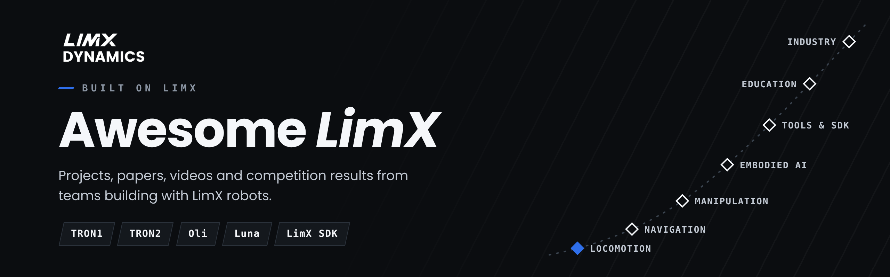

  <b>English</b> | <a href="README_cn.md">中文</a> | <a href="README_ja.md">日本語</a> | <a href="README_ko.md">한국어</a>

  
  
  

> **147** projects and partnerships around LimX robots and the LimX SDK, **99** of them with open-source code: papers, code, datasets, tutorials, competition results and industry deployments. LimX's own releases are on [GitHub](https://github.com/limxdynamics) and [Hugging Face](https://huggingface.co/limxdynamics).

**Find by robot**

| [**TRON1**](robots/TRON1.md) | [**TRON2**](robots/TRON2.md) | [**Oli**](robots/Oli.md) | [**Luna**](robots/Luna.md) | [**P1**](robots/P1.md) | [**W1**](robots/W1.md) |
|:---:|:---:|:---:|:---:|:---:|:---:|
| 90&nbsp;projects | 29&nbsp;projects | 26&nbsp;projects | 6&nbsp;projects | 4&nbsp;projects | 3&nbsp;projects |

## Contents

- [Before you start](#before-you-start)
- [Locomotion & whole-body control](#locomotion--whole-body-control) — 47
  - [Terrain & perceptive locomotion](#terrain--perceptive-locomotion)
  - [RL training & sim-to-real](#rl-training--sim-to-real)
  - [Model-based control](#model-based-control)
  - [Motion tracking & retargeting](#motion-tracking--retargeting)
- [Perception & navigation](#perception--navigation) — 13
- [Manipulation](#manipulation) — 11
- [Embodied AI](#embodied-ai) — 9
- [Tools, simulation & SDK](#tools-simulation--sdk) — 23
  - [Training frameworks](#training-frameworks)
  - [Simulation & environments](#simulation--environments)
  - [Deployment & control](#deployment--control)
  - [Models & motion data](#models--motion-data)
- [Education & competitions](#education--competitions) — 15
- [Industry deployments](#industry-deployments) — 29
  - [Deployments & products](#deployments--products)
  - [Open source from companies](#open-source-from-companies)
  - [Commercial shows & events](#commercial-shows--events)
  - [Strategic partnerships](#strategic-partnerships)
  - [Regional partners & channels](#regional-partners--channels)
  - [Awards & recognition](#awards--recognition)
- [By robot](#by-robot)
- [Contributing](#contributing)

**Code** something to run · **Tutorial** something to follow · **Paper** something to read · **News** a media report or announcement · *sim* shown only in simulation, everything else ran on a real robot

## Before you start

Everything below builds on the same four steps. If you are new, walk them in
order - these are our own repositories, not community projects.

| Step | What you need | Where to get it |
|---|---|---|
| 1 · Models | URDF, MJCF and USD for your robot | [TRON1](https://github.com/limxdynamics/tron1-robot-description) · [TRON2](https://github.com/limxdynamics/tron2-robot-description) · [Oli](https://github.com/limxdynamics/humanoid-description) · [Luna](https://github.com/limxdynamics/luna-description) |
| 2 · Interface | Low-level motion SDK, ROS 2 | [limxsdk-lowlevel](https://github.com/limxdynamics/limxsdk-lowlevel) |
| 3 · Train | Isaac Lab, Isaac Gym, MuJoCo | [tron1-rl-isaaclab](https://github.com/limxdynamics/tron1-rl-isaaclab) · [tron2_rl_lab](https://github.com/limxdynamics/tron2_rl_lab) · [tron1-mujoco-sim](https://github.com/limxdynamics/tron1-mujoco-sim) |
| 4 · Deploy | ONNX runtime, ROS 2, C++ | [tron1-rl-deploy-python](https://github.com/limxdynamics/tron1-rl-deploy-python) · [humanoid-rl-deploy-python](https://github.com/limxdynamics/humanoid-rl-deploy-python) |

**Built something with a LimX robot?** Add it to the list — [submit a project](https://github.com/limxdynamics/awesome-limx/issues/new?template=add-project.yml) (a link is enough), or read [CONTRIBUTING.md](CONTRIBUTING.md) first. Links only; your code stays in your own repository.

## Locomotion & whole-body control

_47 entries in 4 groups: 19 papers · 28 code_

### Terrain & perceptive locomotion

| Project | Robot | Author / Org | Year | Type | Links |
|---|---|---|---|---|---|
| **AME-2**: agile perceptive locomotion | `TRON1` | [ETH Zurich RSL](https://rsl.ethz.ch) | 2026 | Paper | [project](https://sites.google.com/leggedrobotics.com/ame-2)&nbsp;·&nbsp;[paper](https://arxiv.org/abs/2601.08485) |
| **FastStair**: running up stairs | `Oli` | HIT, LimX et al. | 2026 | Paper | [project](https://npcliu.github.io/FastStair)&nbsp;·&nbsp;[paper](https://arxiv.org/abs/2601.10365)&nbsp;·&nbsp;[video](https://youtu.be/SoLBK7VEGDo) |
| **SteppingStoneLocomotion**: stepping stones, blind then with vision | `TRON1`&nbsp;*sim* | [Yiyou6](https://github.com/Yiyou6) | 2026 | Code | [code](https://github.com/Yiyou6/SteppingStoneLocomotion)&nbsp;·&nbsp;[video](https://www.youtube.com/watch?v=vs608-L7kl0) |
| **Height-Adjustable Wheel-Legged RL**: terrain adaptation with body-height adjustment on wheel-foot TRON1 | `TRON1` | GUET, SJTU, ZJU | 2026 | Paper | [paper](https://doi.org/10.1109/amc67705.2026.11435832) |
| **Reference-Guided Stair Climbing**: reference-guided RL for wheel-foot TRON1 on stairs, bachelor's thesis | `TRON1`&nbsp;*sim* | Uppsala University | 2026 | Paper | [paper](http://urn.kb.se/resolve?urn=urn:nbn:se:uu:diva-594330) |
| **AME Locomotion for TRON2A**: AME reproduction in Isaac Lab, extended with a TRON2A legged environment | `TRON2`&nbsp;*sim* | [possibleustc](https://github.com/possibleustc) | 2026 | Code | [code](https://github.com/possibleustc/AME_Locomotion) |
| **Offline Visual Encoder for Biped Locomotion**: vision-based locomotion with an offline-trained depth-to-height encoder, validated on TRON1 | `TRON1` | Huazhong University of Science and Technology | 2026 | Paper | [paper](https://doi.org/10.1109/access.2026.3686506) |
| **BarlowWalk**: terrain-adaptive locomotion | `TRON1`&nbsp;*sim* | HIT Shenzhen | 2025 | Paper | [paper](https://arxiv.org/abs/2508.00939) |
| **CTBC**: blind stair climbing on wheels | `TRON1` | Shanghai University, COWAROBOT | 2025 | Paper | [project](https://ctbc-for-wheeled-bipedal-robots.github.io/)&nbsp;·&nbsp;[paper](https://arxiv.org/abs/2509.02986) |
| **GA-PHL**: gait-adaptive perceptive walking | `Oli` | USTC, LimX et al. | 2025 | Paper | [project](https://ga-phl.github.io/)&nbsp;·&nbsp;[paper](https://arxiv.org/abs/2512.07464) |
| **LIPM-Guided RL**: stable perceptive biped walking | `TRON1` | SUSTech CLEAR Lab, HKUST et al. | 2025 | Paper | [paper](https://arxiv.org/abs/2509.09106) |
| **VMTS**: vision-assisted multi-terrain walking | `P1` | Southeast University | 2025 | Code | [paper](https://arxiv.org/abs/2503.07049)&nbsp;·&nbsp;[code](https://github.com/chenfu-user/VMTS) |

### RL training & sim-to-real

| Project | Robot | Author / Org | Year | Type | Links |
|---|---|---|---|---|---|
| **Biped RL with Pathfinding**: goal-conditioned training with pathfinding | `TRON1`&nbsp;*sim* | [shandilya1998](https://github.com/shandilya1998) | 2026 | Code | [code](https://github.com/singhaman1750/biped-rl-isaaclab-iisc) |
| **OSRAM**: online sim-to-real adaptation | `TRON1` | [Duke University](https://github.com/generalroboticslab) | 2026 | Code | [code](https://github.com/generalroboticslab/OSRAM) |
| **rl-tron1**: Isaac Lab training with teacher-student | `TRON1`&nbsp;*sim* | [Jiakang Ma](https://github.com/Jiakang-Ma) | 2026 | Code | [code](https://github.com/Jiakang-Ma/rl-tron1) |
| **TRON1 Sliding Analysis**: wheel-foot drift and friction transfer | `TRON1`&nbsp;*sim* | [Shukashuki](https://github.com/Shukashuki) | 2026 | Code | [code](https://github.com/Shukashuki/tron1-sliding-analysis) |
| **VAPS**: safe acrobatics, real side flips | `Oli` | TU Darmstadt, LimX et al. | 2026 | Paper | [project](https://vaps-r-al.github.io/)&nbsp;·&nbsp;[paper](https://arxiv.org/abs/2610.01397) |
| **WF_TRON1A Stand-Still Policy**: RL policy for standing still in place | `TRON1`&nbsp;*sim* | [F-Morry](https://github.com/F-Morry) | 2026 | Code | [code](https://github.com/F-Morry/limx_rl) |
| **Where-to-Learn**: gradient-guided RL exploration | `TRON1` | ZJU, SUSTech | 2026 | Paper | [project](https://wheretolearn.github.io)&nbsp;·&nbsp;[paper](https://arxiv.org/abs/2603.27317)&nbsp;·&nbsp;[video](https://www.youtube.com/watch?v=DztdUyh_LVk) |
| **Zetin TRON1 Deploy**: sim-to-sim and sim-to-real deployment | `TRON1` | [Chanjun Lee (UOS Zetin)](https://github.com/chanjun-nyam) | 2026 | Code | [code](https://github.com/chanjun-nyam/Zetin-Humanoid-RL-Deploy) |
| **SF_TRON Ext Estimator**: history-based disturbance estimator added to a depth residual policy for sole-foot TRON1 | `TRON1`&nbsp;*sim* | [EVENWaterOne](https://github.com/EVENWaterOne) | 2026 | Code | [code](https://github.com/EVENWaterOne/SF_TRON_Ext-estimator) |
| **imfs**: foothold planning with a world model and foothold tracking on sole-foot TRON1 in Isaac Gym | `TRON1`&nbsp;*sim* | [Fleming-Sung](https://github.com/Fleming-Sung) | 2026 | Code | [code](https://github.com/Fleming-Sung/imfs) |
| **Shape Your Body**: value-gradient design search across 50 legged robots, TRON1 among them | `TRON1`&nbsp;*sim* | [nico-bohlinger](https://github.com/nico-bohlinger) | 2026 | Code | [code](https://github.com/nico-bohlinger/shape-your-body) |
| **Model-Based Gait Planning RL**: 3D-LIPM reference gaits replace gait rewards in RL training, deployed on TRON1 | `TRON1` | Harbin Institute of Technology | 2026 | Paper | [paper](https://doi.org/10.1016/j.birob.2026.100338) |
| **HIM-PIM Isaac Lab**: robust locomotion with HIM and PIM | `TRON1`&nbsp;*sim* | [DongyangLin](https://github.com/DongyangLin) | 2025 | Code | [code](https://github.com/DongyangLin/HIM-PIM-isaaclab) |
| **LeggedRobotsLab**: Isaac Lab locomotion for Go1 and TRON1A | `TRON1`&nbsp;*sim* | [Guohua Zhang](https://github.com/guohua-zhang) | 2025 | Code | [code](https://github.com/guohua-zhang/LeggedRobotsLab) |
| **Multi-Loco**: one diffusion policy for point-foot and wheel-foot | `TRON1` | SUSTech CLEAR Lab, LimX et al. | 2025 | Code | [project](https://multi-loco.github.io)&nbsp;·&nbsp;[paper](https://arxiv.org/abs/2506.11470)&nbsp;·&nbsp;[code](https://github.com/clearlab-sustech/multi_loco_isaacgym) |
| **PvP**: data-efficient humanoid RL | `Oli` | PolyU, USTC et al. | 2025 | Paper | [paper](https://arxiv.org/abs/2512.13093) |
| **TRON Camp Wheel-Foot Deployment**: wheel-foot policy deployed on hardware | `TRON1` | [Yitao Zeng](https://github.com/24zen0) | 2025 | Code | [code](https://github.com/24zen0/Deployment_of_wheelfoot_tron) |
| **PTRL**: prior transfer between robots to cut RL training time, tested on Go2 and TRON1 | `TRON1` | HIT Shenzhen, Soochow University | 2025 | Paper | [paper](https://arxiv.org/abs/2504.05629) |
| **AnyBipe**: LLM-guided training and deployment for bipeds | `TRON1` | [SJTU](https://github.com/sjtu-mvasl-robotics) | 2024 | Code | [code](https://github.com/sjtu-mvasl-robotics/AnyBipe) |
| **CTS**: concurrent teacher-student RL | `P1` | SUSTech CLEAR Lab, ZJU-UIUC et al. | 2024 | Paper | [project](https://clearlab-sustech.github.io/concurrentTS/)&nbsp;·&nbsp;[paper](https://arxiv.org/abs/2405.10830) |

### Model-based control

| Project | Robot | Author / Org | Year | Type | Links |
|---|---|---|---|---|---|
| **Learning-Enhanced PMP-MPC**: learned-residual MPC for a point-foot biped | `TRON1`&nbsp;*sim* | [Markwcl2004](https://github.com/Markwcl2004) | 2026 | Code | [paper](https://doi.org/10.1109/ASCC70886.2026.11701800)&nbsp;·&nbsp;[code](https://github.com/Markwcl2004/PMP_based_Bipedal_MPC) |
| **Whole-Body Humanoid MPC**: nonlinear whole-body MPC on a 31-DoF Oli | `Oli`&nbsp;*sim* | [Tianxing Liu](https://github.com/liuskywalkerjskd) | 2026 | Code | [code](https://github.com/liuskywalkerjskd/humanoid_mpc) |
| **Terrain-Aware CFR Planning**: convex feasible region planning for stairs, 200 of 200 trials on W1 | `W1` | SUSTech CLEAR Lab | 2026 | Paper | [paper](https://doi.org/10.21203/rs.3.rs-10577407/v1) |
| **Power-Bounded Inverted Pendulum**: maximum-speed model for bipeds, used to retune TRON1 joint motor parameters | `TRON1`&nbsp;*sim* | Zhejiang University | 2026 | Paper | [paper](https://doi.org/10.1007/s10409-026-25928-x) |
| **Hierarchical NMPC + STSMC**: hierarchical nonlinear MPC with super-twisting sliding mode control for wheel-foot TRON1 under uncertainties | `TRON1`&nbsp;*sim* | [pjmcconnellogue](https://github.com/pjmcconnellogue) | 2026 | Code | [code](https://github.com/pjmcconnellogue/Hierarchical-Nonlinear-MPC-and-Super-Twisting-Sliding-Mode-Control-for-a-Wheeled-Biped-Robot-) |
| **Two-Wheeled Robot LQR**: LQR and whole-body control for wheel-foot TRON1, thesis project | `TRON1`&nbsp;*sim* | [alpttex19](https://github.com/alpttex19) | 2025 | Code | [code](https://github.com/alpttex19/Two_Wheeled_Robot_LQR) |
| **Bipedal MPC**: convex MPC and WBC in MuJoCo | `TRON1`&nbsp;*sim* | [SUSTech CLEAR Lab](https://github.com/clearlab-sustech) | 2024 | Code | [code](https://github.com/clearlab-sustech/Bipedal_MPC) |
| **Task-Space Riccati WBC**: whole-body control | `P1`&nbsp;*sim* | SUSTech, HKUST et al. | 2024 | Paper | [paper](https://arxiv.org/abs/2404.00591) |

### Motion tracking & retargeting

| Project | Robot | Author / Org | Year | Type | Links |
|---|---|---|---|---|---|
| **Any2Any**: cross-embodiment whole-body tracking | `Oli` `Luna` | LimX | 2026 | Code | [paper](https://arxiv.org/abs/2605.23733)&nbsp;·&nbsp;[code](https://github.com/Ming827/any2any_sonic2Oli) |
| **CHIP for Oli**: adaptive-compliance motion tracking on mjlab | `Oli`&nbsp;*sim* | [Matt14-mander](https://github.com/Matt14-mander) | 2026 | Code | [code](https://github.com/Matt14-mander/chip-oli) |
| **SuperMimic for Oli**: one policy tracking 40 motions | `Oli`&nbsp;*sim* | [Tianxing Liu](https://github.com/liuskywalkerjskd) | 2026 | Code | [code](https://github.com/liuskywalkerjskd/supermimic_oli) |
| **TRON1 WF Mimic**: dance imitation and feasibility study | `TRON1`&nbsp;*sim* | [HUST-dolores](https://github.com/HUST-dolores) | 2026 | Code | [code](https://github.com/HUST-dolores/tron1-wf-mimic) |
| **robot_lab_srl**: robot_lab extension with motion-mimic tasks for Oli in Isaac Lab | `Oli`&nbsp;*sim* | [song-hl](https://github.com/song-hl) | 2026 | Code | [code](https://github.com/song-hl/robot_lab_srl) |
| **robot_retargeter**: retargets SMPL-X or source-robot motion to humanoids, with an Oli config | `Oli`&nbsp;*sim* | [ccrpRepo](https://github.com/ccrpRepo) | 2026 | Code | [code](https://github.com/ccrpRepo/robot_retargeter) |
| **Multi-Embodiment Retargeting**: diffusion-based motion retargeting | `TRON1` `Oli`&nbsp;*sim* | SUSTech, HKUST et al. | 2025 | Paper | [paper](https://arxiv.org/abs/2505.20857) |

## Perception & navigation

_13 entries: 2 papers · 11 code_

| Project | Robot | Author / Org | Year | Type | Links |
|---|---|---|---|---|---|
| **tron1_navrl**: RL local navigation in Isaac Lab (Korean) | `TRON1`&nbsp;*sim* | [jongbob1918](https://github.com/jongbob1918) | 2026 | Code | [code](https://github.com/jongbob1918/tron1_navrl) |
| **TRON1 Multi-floor Navigation**: flat driving, floor changes and stairs as one mission (Korean) | `TRON1` | [justpastmarch](https://github.com/justpastmarch) | 2026 | Code | [code](https://github.com/justpastmarch/TRON1_multifloor-navigation) |
| **Geometric Candidate Modes**: learning navigation from multimodal demonstrations, sim-trained policy transferred to TRON1 | `TRON1` | Ohio State University | 2026 | Paper | [paper](https://arxiv.org/abs/2610.20241) |
| **ros2_gnss_waypoint_nav**: map-free outdoor waypoint navigation with RTK GNSS, MID360 and Nav2, with a TRON1 base bridge | `TRON1` | [WHU BRAIN Lab](https://github.com/Whu-BrainLab) | 2026 | Code | [code](https://github.com/Whu-BrainLab/ros2_gnss_waypoint_nav) |
| **LightNav-0**: VLM navigation stack with MPC tracking and a web panel, adapters for Go2 and TRON1 | `TRON1` | [Light Origins](https://github.com/lightorigins) | 2026 | Code | [paper](https://arxiv.org/abs/2608.30935)&nbsp;·&nbsp;[code](https://github.com/lightorigins/LightNav-0)&nbsp;·&nbsp;[model](https://huggingface.co/LightOriginsHQ/LightNav-0) |
| **GPS-TRON1**: outdoor GPS navigation with FAST-LIO | `TRON1` | [potatoHu-a](https://github.com/potatoHu-a) | 2026 | Code | [code](https://github.com/potatoHu-a/GPS-TRON1) |
| **WF_TRON1A LiDAR Navigation**: LiDAR odometry and navigation | `TRON1` | [F-Morry](https://github.com/F-Morry) | 2026 | Code | [code](https://github.com/F-Morry/limx_ws) |
| **WAVE-Go**: world-model action adaptation for long-range navigation, real Go2-W plus a Luna rollout in MuJoCo | `Luna`&nbsp;*sim* | BIT, HKU, LimX et al. | 2026 | Code | [paper](https://arxiv.org/abs/2609.18193)&nbsp;·&nbsp;[code](https://github.com/vigorlee/wave-go) |
| **Hourglass**: cross-embodiment motion planning with a body-agnostic world model, TRON1 among seven training robots | `TRON1`&nbsp;*sim* | Nanyang Technological University | 2026 | Paper | [paper](https://arxiv.org/abs/2610.41330) |
| **TRON-1 Struzzo**: autonomous navigation with a Jetson | `TRON1` | [enfff](https://github.com/enfff) | 2025 | Code | [code](https://github.com/enfff/tron1-gazebo-ros2) |
| **NeuPAN on TRON1**: end-to-end NeuPAN navigation on wheels | `TRON1` | [WikHClean](https://github.com/WikHClean) | 2025 | Code | [code](https://github.com/WikHClean/-ROS1-NeuPAN-TRON1-) |
| **3D Navigation with PCT Planner**: 3D navigation on stairs | `TRON1` | [81578823](https://github.com/81578823) | 2025 | Code | [code](https://github.com/81578823/3D_navigation_PCTplanner) |
| **EROAM**: event-camera rotational odometry, with sequences recorded on TRON1 | `TRON1` | [wlxing1901](https://github.com/wlxing1901) | 2024 | Code | [project](https://wlxing1901.github.io/eroam/)&nbsp;·&nbsp;[paper](https://arxiv.org/abs/2411.11004)&nbsp;·&nbsp;[code](https://github.com/wlxing1901/eroam)&nbsp;·&nbsp;[video](https://youtu.be/8tF6b2VuvSM) |

## Manipulation

_11 entries: 5 papers · 6 code_

| Project | Robot | Author / Org | Year | Type | Links |
|---|---|---|---|---|---|
| **COLA on TRON2**: human-robot collaborative carrying, TRON2 port | `TRON2`&nbsp;*sim* | [Matt14-mander](https://github.com/Matt14-mander) | 2026 | Code | [code](https://github.com/Matt14-mander/COLA_TRON2) |
| **Holistic Loco-Manipulation**: TRON1 with an arm | `TRON1` | ZJU-UIUC, LimX | 2026 | Paper | [paper](https://arxiv.org/abs/2609.18930) |
| **TRON1-to-UR5e Bottle Transfer**: ROS 2 and MuJoCo | `TRON1`&nbsp;*sim* | [Centaucyan](https://github.com/Centaucyan) | 2026 | Code | [code](https://github.com/Centaucyan/Proj_Transferring_bottle_from_tron1_to_ur5e_in_mujoco_env) |
| **Cooperative Transportation**: two wheel-legged robots carry a load | `TRON1` `TRON2`&nbsp;*sim* | [Matt14-mander](https://github.com/Matt14-mander) | 2026 | Code | [code](https://github.com/Matt14-mander/Multiple_Humanoid_Cooperative_Transportation) |
| **CWI**: whole-body imitation for loco-manipulation | `Oli` | LimX, HKU et al. | 2026 | Paper | [project](https://cwi-ral.github.io/CWI-RAL-Webpage/)&nbsp;·&nbsp;[paper](https://arxiv.org/abs/2606.27676) |
| **Arm-TRON**: reconfigurable biped with an arm | `TRON1` | SUSTech, ZJU et al. | 2026 | Paper | [paper](https://doi.org/10.1109/TMECH.2026.3727546) |
| **TRON2 Cooperative Carrying**: research platform for two TRON2 robots carrying a load together, MuJoCo with LimX SDK interfaces | `TRON2`&nbsp;*sim* | [Matt14-mander](https://github.com/Matt14-mander) | 2026 | Code | [code](https://github.com/Matt14-mander/tron2-cooperative-carrying) |
| **Mobile Pedipulation**: hierarchical NMPC that lets wheel-foot TRON1 slide objects with its wheeled legs, RA-L | `TRON1` | University of Michigan | 2026 | Paper | [paper](https://arxiv.org/abs/2606.19233) |
| **UMI on Tron1**: UMI skills with an ARX5 arm on a real TRON1 | `TRON1` | [Czy213hd](https://github.com/Czy213hd) | 2025 | Code | [code](https://github.com/Czy213hd/umi-on-tron-lab) |
| **Quest VR Teleop for Oli**: Meta Quest arm and head teleoperation | `Oli` | [MSTLE](https://github.com/MSTLE) | 2025 | Code | [code](https://github.com/MSTLE/Limx_teleoperate-end_pose) |
| **Wheeled-Quadrupedal Manipulator**: W1 with an arm, pose tracking | `W1` | SUSTech CLEAR Lab, ZJU-UIUC et al. | 2024 | Paper | [project](https://clearlab-sustech.github.io/RFM_loco_mani/)&nbsp;·&nbsp;[paper](https://arxiv.org/abs/2412.03012) |

## Embodied AI

_9 entries: 2 papers · 7 code_

| Project | Robot | Author / Org | Year | Type | Links |
|---|---|---|---|---|---|
| **Tron 1 Hermes Agent**: self-improving local AI agent driving TRON1 in MuJoCo on a Mac | `TRON1`&nbsp;*sim* | [justinsuo](https://github.com/justinsuo) | 2026 | Code | [code](https://github.com/justinsuo/tron1-hermes-agent) |
| **FluxVLA on TRON2**: train and deploy FluxVLA on your own TRON2 | `TRON2` | [emoPointer](https://github.com/emoPointer) | 2026 | Code | [code](https://github.com/emoPointer/FluxVLA) |
| **Oli Voice Interaction**: voice dialogue and action control | `Oli` | [zhilin2025](https://github.com/zhilin2025) | 2026 | Code | [code](https://github.com/zhilin2025/oli_audio) |
| **HWAM**: humanoid world action model | `Oli` | LimX | 2026 | Paper | [project](https://hwam.vercel.app/)&nbsp;·&nbsp;[paper](https://arxiv.org/abs/2610.12026) |
| **ACG-WAM**: world-action model with dexterous hands | `TRON2` | BIT, LimX | 2026 | Code | [project](https://RoboOpus.github.io/ACG-WAM)&nbsp;·&nbsp;[paper](https://arxiv.org/abs/2610.06965)&nbsp;·&nbsp;[code](https://github.com/RoboOpus/ACG-WAM) |
| **GR00T Drifting Heads**: one-step action heads | `TRON2` | ZJU-UIUC, LimX | 2026 | Paper | [paper](https://arxiv.org/abs/2609.18108) |
| **TRON2 Garment Feeder**: Pi0.5 policy | `TRON2` | [voniu](https://huggingface.co/voniu) | 2026 | Code | [model](https://huggingface.co/voniu/tron2-garment-feeder-button-pi05) |
| **TRON2 LeRobot Datasets**: datasets and GR00T fine-tunes | `TRON2` | [trantor2nd](https://huggingface.co/trantor2nd) | 2026 | Code | [model](https://huggingface.co/models?author=trantor2nd&search=tron2)&nbsp;·&nbsp;[dataset](https://huggingface.co/datasets?author=trantor2nd&search=tron2) |
| **TRONCamp Pi0.5 Policies**: Pi0.5 checkpoints for flower arranging and cloth folding on TRON2 | `TRON2` | [toki1231](https://huggingface.co/toki1231) | 2026 | Code | [model](https://huggingface.co/toki1231) |

## Tools, simulation & SDK

_23 tools in 4 groups_

### Training frameworks

| Project | Robot | Author / Org | Year | Links |
|---|---|---|---|---|
| **TRON1 Isaac Lab Tasks**: Isaac Lab tasks for all three feet, incl. jumping | `TRON1` | [HughWang-wzy](https://github.com/HughWang-wzy) | 2026 | [code](https://github.com/HughWang-wzy/tron1-rl-isaaclab) |
| **tron1-rl-mjlab**: wheel-foot training on mjlab | `TRON1` | [Xinchen Yao](https://github.com/hoscy) | 2025 | [code](https://github.com/hoscy/tron1-rl-mjlab) |
| **LeggedGym-Ex**: legged_gym on Genesis, Isaac Gym and Isaac Sim | `TRON1` | [Yasen Jia](https://github.com/lupinjia) | 2024 | [code](https://github.com/lupinjia/LeggedGym-Ex) |
| **bipedal_locomotion_isaaclab**: Isaac Lab training, sim-to-real | `TRON1` | [Andy-xiong6 (SUSTech)](https://github.com/Andy-xiong6) | 2024 | [code](https://github.com/Andy-xiong6/bipedal_locomotion_isaaclab) |

### Simulation & environments

| Project | Robot | Author / Org | Year | Links |
|---|---|---|---|---|
| **tron2-wuji-bag-replay**: replay TRON2 + Wuji hand trajectories in Isaac Sim | `TRON2` | [zengxiong111](https://github.com/zengxiong111) | 2026 | [code](https://github.com/zengxiong111/tron2-wuji-bag-replay) |
| **MetalSim**: Apple-silicon simulator with a TRON1 scene | `TRON1` | [Aditya Pulipaka](https://github.com/pulipakaa24) | 2026 | [code](https://github.com/pulipakaa24/MetalSim) |
| **robot-sim-docker**: containers for LimX Gazebo, Isaac Lab, MuJoCo | `TRON1` | [Aklva](https://github.com/Aklva) | 2026 | [code](https://github.com/Aklva/robot-sim-docker) |
| **limx-robotics-mcp**: MCP server for sim and control | `TRON1` `Oli` | [sandraschi](https://github.com/sandraschi) | 2026 | [code](https://github.com/sandraschi/limx-robotics-mcp) |
| **tron_docker_sim**: Docker image for Gazebo sim | `TRON1` | [The-RoboTUM](https://github.com/The-RoboTUM) | 2026 | [code](https://github.com/The-RoboTUM/tron_docker_sim) |
| **roqsim**: plugin-driven MuJoCo simulation framework, Oli among its bundled humanoids | `Oli` | [cps-test-lab](https://github.com/cps-test-lab) | 2026 | [code](https://github.com/cps-test-lab/roqsim) |
| **Gewu (Unity RL Playground)**: Unity training platform from the national humanoid robot innovation center, Shanghai University and Tsinghua, ships TRON1 walk, drive and jump policies | `TRON1` | [loongOpen](https://github.com/loongOpen) | 2025 | [paper](https://arxiv.org/abs/2503.05146)&nbsp;·&nbsp;[code](https://github.com/loongOpen/Unity-RL-Playground) |
| **ARC Bridge**: controller-to-MuJoCo bridge for TRON1 | `TRON1` | [UMich ARCaD Lab](https://github.com/ARCaD-Lab-UM) | 2024 | [code](https://github.com/ARCaD-Lab-UM/arc-bridge) |

### Deployment & control

| Project | Robot | Author / Org | Year | Links |
|---|---|---|---|---|
| **tron1_ctrl_ros2**: ROS 2 control package wrapping the TRON1 WebSocket SDK | `TRON1` | [Turing-zero](https://github.com/Turing-zero) | 2026 | [code](https://github.com/Turing-zero/tron1_ctrl_ros2) |
| **tron2_camera_calibration**: head and wrist camera calibration tools for TRON2 | `TRON2` | [zengxiong111](https://github.com/zengxiong111) | 2026 | [code](https://github.com/zengxiong111/tron2_camera_calibration) |
| **tron1_wheel_gui**: Qt control panel for a real TRON1 | `TRON1` | [Yang Zhuqi](https://github.com/Y20-code-cpu) | 2026 | [code](https://github.com/Y20-code-cpu/tron1_wheel_gui) |
| **wf_tron1b_deploy**: depth-perceptive policy sim-to-sim | `TRON1` | [Leixin Chang](https://github.com/Leixinjonaschang) | 2026 | [code](https://github.com/Leixinjonaschang/wf_tron1b_deploy) |
| **Tron_Deploy**: deploy policies from Windows | `TRON1` | [candi4](https://github.com/candi4) | 2026 | [code](https://github.com/candi4/Tron_Deploy) |
| **CRL Humanoid ROS**: ROS 2 framework for G1 and TRON1A | `TRON1` | [Jin Cheng (ETH Zurich CRL)](https://github.com/catachiii) | 2025 | [code](https://github.com/catachiii/crl-humanoid-ros) |
| **websocket_ros**: Docker bridge from the TRON1 WebSocket API to ROS, with a fake robot for testing without hardware | `TRON1` | [daweidavidwang](https://github.com/daweidavidwang) | 2025 | [code](https://github.com/daweidavidwang/websocket_ros) |

### Models & motion data

| Project | Robot | Author / Org | Year | Links |
|---|---|---|---|---|
| **RIMKit**: contact-aware retargeting, Oli included | `Oli` | [Taemoon Jeong](https://github.com/tmjeong1103) | 2026 | [code](https://github.com/tmjeong1103/RIMKit) |
| **tron2_revo3_description**: TRON2 with BrainCo Revo3 hands | `TRON2` | [ENDLESS0321](https://github.com/ENDLESS0321) | 2026 | [code](https://github.com/ENDLESS0321/tron2_revo3_description) |
| **robot_descriptions.py**: load TRON1, TRON2, Oli, Luna models in one line | `TRON1` `TRON2` `Oli` `Luna` | [robot-descriptions](https://github.com/robot-descriptions) | 2026 | [code](https://github.com/robot-descriptions/robot_descriptions.py) |
| **limx-3d-measurement-workbench**: browse TRON models, measure dimensions | `TRON1` `TRON2` | [voniu](https://github.com/voniu) | 2026 | [code](https://github.com/voniu/limx-3d-measurement-workbench) |

## Education & competitions

_15 entries: 2 papers · 12 code · 1 tutorial_

| Project | Robot | Author / Org | Year | Type | Links |
|---|---|---|---|---|---|
| **ATEC 2026 Simulation Challenge**: official challenge with TRON1 and TRON2A tracks | `TRON1` `TRON2`&nbsp;*sim* | [ATEC](https://github.com/atecup) | 2026 | Code | [code](https://github.com/atecup/ATEC2026_Simulation_Challenge) |
| **TRONCamp 2026 Mani Solution**: ACT dual-arm manipulation | `TRON2`&nbsp;*sim* | [han-xudong](https://github.com/han-xudong) | 2026 | Code | [code](https://github.com/han-xudong/troncamp-mani) |
| **TRONCamp 2026 Locomotion Solution**: SFYG TRON2A RL policy | `TRON2`&nbsp;*sim* | [han-xudong](https://github.com/han-xudong) | 2026 | Code | [code](https://github.com/han-xudong/troncamp-locomotion) |
| **study_tron1**: setup notes and learning log | `TRON1`&nbsp;*sim* | [beamkeerati](https://github.com/beamkeerati) | 2026 | Code | [code](https://github.com/beamkeerati/study_tron1) |
| **OpenArm Mobile Manipulation Lab**: TRON1 + OpenArm, LLM missions (Korean) | `TRON1`&nbsp;*sim* | [aha645](https://github.com/aha645) | 2026 | Code | [code](https://github.com/aha645/openarms_llm_ex) |
| **LimX Tron1 Learning**: interactive Isaac Lab guide | `TRON1`&nbsp;*sim* | [jessiezhg](https://huggingface.co/jessiezhg) | 2026 | Tutorial | [tutorial](https://huggingface.co/spaces/jessiezhg/LimX-Tron1-Learning) |
| **Zetin RoboCup 2026**: walking, ball tracking and shooting for a sole-foot TRON1 soccer robot in Isaac Lab (Korean) | `TRON1`&nbsp;*sim* | [tae2yi](https://github.com/tae2yi) | 2026 | Code | [code](https://github.com/tae2yi/Zetin_Robocup2026) |
| **Conducting Evaluation System**: music-conducting demonstration and scoring for teaching, shown on the Oli digital twin | `Oli`&nbsp;*sim* | Guangdong Peizheng College | 2026 | Paper | [paper](https://doi.org/10.1145/3806980.3807204) |
| **Every Embodied: TRONCamp Mani**: Datawhale's open embodied-AI course, with a TRONCamp Mani chapter on TRON2 dual-arm tasks (Chinese) | `TRON2`&nbsp;*sim* | [Datawhale](https://github.com/datawhalechina) | 2026 | Code | [code](https://github.com/datawhalechina/every-embodied/tree/main/15-Challenge%E7%AB%9E%E8%B5%9B/TRONCamp-Mani) |
| **ATEC 2026 Wheel-Legged Entry**: a team's RL training and simulation deployment for the ATEC 2026 challenge | `TRON1` `TRON2`&nbsp;*sim* | [Logic-TARS](https://github.com/Logic-TARS) | 2026 | Code | [code](https://github.com/Logic-TARS/ATEC2026) |
| **Zetin RoboCup Control**: match code for RoboCup 2026: a TRON1 lower body with a team-built upper body and camera (Korean) | `TRON1` | [newb-ops (UOS ZETIN)](https://github.com/newb-ops) | 2026 | Code | [code](https://github.com/newb-ops/robocup-control-portfolio) |
| **Hands-on Embodied AI**: open course from algorithms to real robots, with outdoor GNSS and Nav2 navigation on point-foot and wheel-foot TRON1 (Chinese) | `TRON1` | [WHU BRAIN Lab](https://github.com/Whu-BrainLab) | 2025 | Code | [code](https://github.com/Whu-BrainLab/Embodied-AI-Tutorial)&nbsp;·&nbsp;[tutorial](https://mp.weixin.qq.com/s/YLKVi09hgImSuWUr_S6gJA) |
| **Canton Tower Robot Climbing Challenge**: champion and best precision control, with FastStair | `Oli` | LimX | 2025 | Paper | [paper](https://arxiv.org/abs/2601.10365)&nbsp;·&nbsp;[result](https://www.sfccn.com/2026/1-1/5NMDE0NzNfMjA5MzM5NA.html) |
| **RL Bipedal Locomotion**: SUSTech ACR2025 course project | `TRON1`&nbsp;*sim* | [81578823 (SUSTech)](https://github.com/81578823) | 2025 | Code | [code](https://github.com/81578823/RL_bipedal_locomotion_Isaaclab) |
| **pointfootGym**: Isaac Gym course template | `TRON1`&nbsp;*sim* | [Haokai Su (SUSTech CLEAR Lab)](https://github.com/SuDaxia-kai) | 2024 | Code | [code](https://github.com/SuDaxia-kai/pointfootGym) |

## Industry deployments

_29 entries in 6 groups_

### Deployments & products

| Project | Robot | Author / Org | Year | Type | Links |
|---|---|---|---|---|---|
| **TENNIIX ULTRA MAX**: tennis robot on a TRON2 wheel-legged base, played at the 2026 Billie Jean King Cup Finals | `TRON2` | Enhanced Robotics (Tenniix) | 2026 | News | [news](https://www.news.cn/sports/20260928/f1776d7ca75042568a5137e256fa9425/c.html) |
| **ZINOVA Tool Intelligence**: two TRON2s with a nail gun and rebar on a scaled tilt-up concrete job | `TRON2` | ZINOVA, RIC Robotics | 2026 | News | [video](https://www.youtube.com/watch?v=8KDxnT-4zl0)&nbsp;·&nbsp;[news](https://www.equipmentworld.com/technology/article/15836367/zinova-limx-bring-toolwielding-robots-to-construction) |
| **Domestic Electronic Architecture Humanoid**: Oli running Dongtu's Intewell OS and AUTBUS bus, released jointly | `Oli` | Kyland (Dongtu Technology) | 2026 | News | [news](http://mp.weixin.qq.com/s?__biz=Mzk0NDU5NjMwMA==&mid=2247495106&idx=1&sn=8b5ffd05d0615a0581d3b23a18f2d830&chksm=c20243eecd5be209a820feecab39fcb0480f5ec903b40f0d655db8f6225b378bd0e8f1db3a1a)&nbsp;·&nbsp;[news](https://m.21jingji.com/article/20260929/herald/af2d0b02d6e7593ed4a2af7d05a191b5.html) |
| **RDK S100 on TRON1**: point-foot TRON1 locomotion policy moved to D-Robotics' RDK S100 BPU, an official application case of the board | `TRON1` | D-Robotics | 2025 | News | [news](https://forum.d-robotics.cc/t/topic/28833) |

### Open source from companies

| Project | Robot | Author / Org | Year | Type | Links |
|---|---|---|---|---|---|
| **Xense OpenPI**: Pi0.5 training configs and real-time inference for TRON2 | `TRON2` | [Xense Robotics](https://github.com/XenseRobotics-AI) | 2026 | Code | [code](https://github.com/XenseRobotics-AI/xense-openpi) |
| **TRON2 Description, Crest edition**: TRON2 models adjusted for a wrist camera mount on the SFYG arm | `TRON2` | [Crest Robotics](https://github.com/Crest-Robotics) | 2026 | Code | [code](https://github.com/Crest-Robotics/tron2-robot-description) |
| **TRON1 Nav2 in Newton**: Nav2 route tests for TRON1 in the Newton simulator | `TRON1`&nbsp;*sim* | [Artefacts](https://github.com/art-e-fact) | 2026 | Code | [code](https://github.com/art-e-fact/tron-navigation-demo) |
| **LeRobot Pico4 Teleoperator**: PICO 4 bimanual teleoperation plugin for LeRobot, with TRON2 support | `TRON2` | [Xense Robotics](https://github.com/XenseRobotics-AI) | 2026 | Code | [code](https://github.com/XenseRobotics-AI/lerobot-teleoperator-pico4) |
| **SONIC Training for HU_D04**: GEAR-SONIC whole-body control on the 31-DOF Oli, with PICO VR teleoperation | `Oli`&nbsp;*sim* | [SafeSentinel](https://github.com/safe-sentinel-co) | 2026 | Code | [code](https://github.com/safe-sentinel-co/hu_d04_sonic_setup) |
| **ANIMA ROS 2 Simulation Network**: ROS 2 and Gazebo simulation stack that ships a TRON1 biped | `TRON1`&nbsp;*sim* | [RobotFlow Labs](https://github.com/RobotFlow-Labs) | 2026 | Code | [code](https://github.com/RobotFlow-Labs/anima-ros2-sim-net) |
| **TRON1 Artefacts Workspace**: ROS 2 and Gazebo demo with the Artefacts robot-testing platform | `TRON1`&nbsp;*sim* | [Artefacts](https://github.com/art-e-fact) | 2026 | Code | [code](https://github.com/art-e-fact/tron1-artefacts) |
| **OM1-sim**: Isaac Sim setup for the OM1 robot OS, with wheel-foot TRON1 next to Go2 and G1 | `TRON1`&nbsp;*sim* | [OpenMind](https://github.com/OpenMind) | 2026 | Code | [code](https://github.com/OpenMind/OM1-sim) |
| **Phanthy Motus Drivers**: hardware drivers for 4Paradigm's Phanthy Motus embodied AI platform, TRON2 dual-arm included | `TRON2` | [4Paradigm](https://github.com/4paradigm) | 2026 | Code | [code](https://github.com/4paradigm/phanthymotus-driver) |
| **Xense TRON2 Pick-and-Place Dataset**: 115 teleoperated episodes with tactile video, also republished by Voxel51 in FiftyOne format | `TRON2` | [Xense Robotics](https://huggingface.co/Xense) | 2026 | Code | [dataset](https://huggingface.co/datasets/Xense/tron2rt-pnp-0918)&nbsp;·&nbsp;[dataset](https://huggingface.co/datasets/Voxel51/xense-tron2rt-pnp-115ep) |
| **ANIMA ROS 2 Bridge**: DDS and WebSocket bridge from AI agents to ROS 2 robots, detects LimX robots and ships TRON1 models | `TRON1`&nbsp;*sim* | [RobotFlow Labs](https://github.com/RobotFlow-Labs) | 2026 | Code | [code](https://github.com/RobotFlow-Labs/anima-ros2-bridge) |
| **OpenMind BrainPack**: modular compute and development backpack integrated with TRON1, Unitree G1 and Go2 | `TRON1` | [OpenMind](https://github.com/OpenMind) | 2025 | Code | [code](https://github.com/OpenMind/brainpack) |

### Commercial shows & events

| Project | Robot | Author / Org | Year | Type | Links |
|---|---|---|---|---|---|
| **NIO at the GBA Auto Show**: Oli and Luna run interactive demos at the NIO booth | `Oli` `Luna` | NIO | 2026 | News | [news](https://news.ifeng.com/c/8vmGa3sP4u7) |
| **Kill It: Style Creator War finale**: Luna on stage in designer Kim Na-ra's winning final, tvN | `Luna` | tvN, Kim Na-ra | 2026 | News | [news](https://isplus.com/article/view/isp202607290025)&nbsp;·&nbsp;[news](https://mikekalil.com/blog/the-rise-of-limx-dynamics/) |
| **Taobao Influencer Festival**: Luna's runway walk with actress Michelle Chen in Shanghai | `Luna` | Taobao | 2026 | News | [news](https://mikekalil.com/blog/limx-dynamics-luna-humanoid-robot/) |

### Strategic partnerships

| Project | Robot | Author / Org | Year | Type | Links |
|---|---|---|---|---|---|
| **SmartCube**: official partner in Korea, humanoids for factory and energy-site inspection with digital twins | — | SmartCube (Korea) | 2026 | News | [news](https://www.aipostkorea.com/news/articleView.html?idxno=12727) |
| **Guangyang Shares**: joint development of integrated joint modules: bearings, gears, reducers and drivers (supply chain) | — | Guangyang Shares | 2026 | News | [news](https://www.nbd.com.cn/articles/2026-03-09/4285402.html)&nbsp;·&nbsp;[news](https://finance.eastmoney.com/a/202603093666208673.html) |
| **SAIC Beijing Joint Lab**: embodied AI joint lab for automotive manufacturing, LimX as SAIC's first embodied AI partner | — | SAIC Beijing | 2025 | News | [news](https://www.pingwest.com/a/306356) |

### Regional partners & channels

| Project | Robot | Author / Org | Year | Type | Links |
|---|---|---|---|---|---|
| **Knoxlabs**: TRON2 and Oli bundles with teleoperation setup for data collection (US) | `TRON2` `Oli` | Knoxlabs | 2026 | News | [news](https://www.knoxlabs.com/blogs/articles/robot-teleoperation-data-collection-limx) |
| **TRON K.K.**: humanoid system integration and Omniverse simulation in Japan, with LimX robots | — | TRON K.K. (Japan) | 2026 | News | [news](https://tron.tokyo/en/service/limx-dynamics/) |
| **Robot Bank**: rollout of TRON1, TRON2 and Oli in Japan with on-site deployment support | `TRON1` `TRON2` `Oli` | Robot Bank (Japan) | 2026 | News | [news](https://robotstart.info/article/2026/05/15/381891.html) |
| **Synerex**: official partner in Korea, TRON1's Korean debut at Drone Show Korea 2025 | `TRON1` | Synerex (Korea) | 2025 | News | [news](https://www.newswire.co.kr/newsRead.php?no=1005949) |
| **R2C2**: official developer and distributor in Hong Kong, RL robots for utility and inspection work | `W1` `P1` | R2C2 Limited (Hong Kong) | 2024 | News | [news](https://www.linkedin.com/posts/limx-dynamics_robotics-partnership-innovation-activity-7211709457666310145-ddt9) |

### Awards & recognition

| Project | Robot | Author / Org | Year | Type | Links |
|---|---|---|---|---|---|
| **IEEE Spectrum Robot of the Month**: TRON1 featured as Robot of the Month in IEEE Spectrum magazine | `TRON1` | IEEE Spectrum | 2026 | News | [news](https://doi.org/10.1109/MSPEC.2026.11595926) |
| **RBR50 Robotics Innovation Awards 2025**: TRON1 recognized as a multi-modal biped R&D platform | `TRON1` | The Robot Report | 2025 | News | [result](https://www.therobotreport.com/rbr50-company-2025/tron-1-multi-modal-biped-offers-a-unique-rd-platform/) |

## By robot

Each robot has its own page with every entry that uses it: [TRON1](robots/TRON1.md) · [TRON2](robots/TRON2.md) · [Oli](robots/Oli.md) · [Luna](robots/Luna.md) · [P1](robots/P1.md) · [W1](robots/W1.md)

Entries per robot and section:

| Robot | Total | Locomotion | Perception | Manipulation | Embodied AI | Tools | Education | Industry |
|---|---:|---:|---:|---:|---:|---:|---:|---:|
| [`TRON1`](robots/TRON1.md) | **90** | 32 | 12 | 6 | 1 | 18 | 10 | 11 |
| [`TRON2`](robots/TRON2.md) | **29** | 1 |  | 3 | 6 | 5 | 5 | 9 |
| [`Oli`](robots/Oli.md) | **26** | 11 |  | 2 | 2 | 4 | 2 | 5 |
| [`Luna`](robots/Luna.md) | **6** | 1 | 1 |  |  | 1 |  | 3 |
| [`P1`](robots/P1.md) | **4** | 3 |  |  |  |  |  | 1 |
| [`W1`](robots/W1.md) | **3** | 1 |  | 1 |  |  |  | 1 |

## Contributing

Self-nominations and suggestions are welcome: use the [submission form](https://github.com/limxdynamics/awesome-limx/issues/new?template=add-project.yml), open a pull request, or email [opensource@limxdynamics.com](mailto:opensource@limxdynamics.com). See [CONTRIBUTING.md](CONTRIBUTING.md) for the criteria. Entries are newest first within each section; the Type column says what a reader gets: something to run (**Code**), something to follow (**Tutorial**), or something to read (**Paper**).

A listing is not an endorsement, and all rights stay with the owners. Owners can ask to be removed at any time, for any reason.

For partnership and procurement inquiries, contact [opensource@limxdynamics.com](mailto:opensource@limxdynamics.com).

## License

This list is released under [CC0 1.0](LICENSE). Linked projects keep their own licenses.
