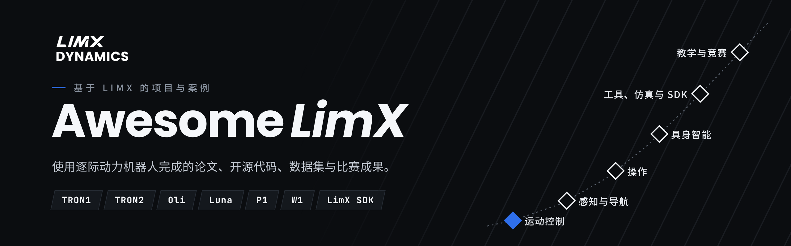

&nbsp;&nbsp;

  
  
  

合作采购请联系 <a href="mailto:opensource@limxdynamics.com">opensource@limxdynamics.com</a>

收录所有使用 LimX 硬件或软件的公开成果：论文、开源代码、数据集、教程和比赛成绩。官方开源仓库请见 [GitHub](https://github.com/limxdynamics) 和 [Hugging Face](https://huggingface.co/limxdynamics)。

**81** 个项目 · **62** 个有开源代码 ｜ [快速上手](#快速上手) · [运动控制](#运动控制) 32 · [感知与导航](#感知与导航) 5 · [操作](#操作) 9 · [具身智能](#具身智能) 7 · [工具、仿真与 SDK](#工具仿真与-sdk) 19 · [教学与竞赛](#教学与竞赛) 9 · [参与贡献](#参与贡献)

<b>按机型查找</b>：TRON1 52 · TRON2 15 · Oli 17 · Luna 2 · P1 3 · W1 1

- **TRON1**：[梅花桩行走](#p-steppingstonelocomotion) · [OSRAM](#p-osram) · [Zetin TRON1 部署](#p-zetin-tron1-deploy) · [WF_TRON1A 静止站立](#p-wf_tron1a-stand-still-policy) · [rl-tron1](#p-rl-tron1) · [目标导向双足训练](#p-biped-rl-with-pathfinding) · [TRON1 打滑分析](#p-tron1-sliding-analysis) · [学习增强的 PMP-MPC](#p-learning-enhanced-pmp-mpc) · [TRON1 轮足舞蹈模仿](#p-tron1-wf-mimic) · [Where-to-Learn](#p-where-to-learn) · [AME-2](#p-ame-2) · [TRON Camp 轮足部署](#p-tron-camp-wheel-foot-deployment) · [HIM-PIM Isaac Lab](#p-him-pim-isaac-lab) · [Multi-Loco](#p-multi-loco) · [LeggedRobotsLab](#p-leggedrobotslab) · [LIPM 引导强化学习](#p-lipm-guided-rl) · [CTBC](#p-ctbc) · [BarlowWalk](#p-barlowwalk) · [多本体动作重定向](#p-multi-embodiment-retargeting) · [AnyBipe](#p-anybipe) · [双足 MPC](#p-bipedal-mpc) · [GPS-TRON1](#p-gps-tron1) · [WF_TRON1A 激光导航](#p-wf_tron1a-lidar-navigation) · [TRON-1 Struzzo](#p-tron-1-struzzo) · [TRON1 上的 NeuPAN](#p-neupan-on-tron1) · [PCT 规划器 3D 导航](#p-3d-navigation-with-pct-planner) · [全身一体化移动操作](#p-holistic-loco-manipulation) · [TRON1 与 UR5e 交接水瓶](#p-tron1-to-ur5e-bottle-transfer) · [多机协同搬运](#p-cooperative-transportation) · [Arm-TRON](#p-arm-tron) · [UMI on Tron1](#p-umi-on-tron1) · [MetalSim](#p-metalsim) · [tron1_wheel_gui](#p-tron1_wheel_gui) · [robot-sim-docker](#p-robot-sim-docker) · [TRON1 Isaac Lab 任务集](#p-tron1-isaac-lab-tasks) · [robot_descriptions.py](#p-robot_descriptionspy) · [wf_tron1b_deploy](#p-wf_tron1b_deploy) · [Tron_Deploy](#p-tron_deploy) · [limx-3d-measurement-workbench](#p-limx-3d-measurement-workbench) · [limx-robotics-mcp](#p-limx-robotics-mcp) · [tron_docker_sim](#p-tron_docker_sim) · [CRL Humanoid ROS](#p-crl-humanoid-ros) · [tron1-rl-mjlab](#p-tron1-rl-mjlab) · [ARC Bridge](#p-arc-bridge) · [LeggedGym-Ex](#p-leggedgym-ex) · [bipedal_locomotion_isaaclab](#p-bipedal_locomotion_isaaclab) · [ATEC 2026 仿真挑战赛](#p-atec-2026-simulation-challenge) · [study_tron1](#p-study_tron1) · [OpenArm 移动操作实训](#p-openarm-mobile-manipulation-lab) · [LimX Tron1 Learning](#p-limx-tron1-learning) · [双足运动强化学习](#p-rl-bipedal-locomotion) · [pointfootGym](#p-pointfootgym)
- **TRON2**：[COLA on TRON2](#p-cola-on-tron2) · [多机协同搬运](#p-cooperative-transportation) · [在 TRON2 上部署 FluxVLA](#p-fluxvla-on-tron2) · [ACG-WAM](#p-acg-wam) · [GR00T 漂移动作头](#p-drifting-action-heads-for-gr00t-n17) · [TRON2 服装送料](#p-tron2-garment-feeder) · [TRON2 LeRobot 数据集](#p-tron2-lerobot-datasets) · [tron2_camera_calibration](#p-tron2_camera_calibration) · [tron2-wuji-bag-replay](#p-tron2-wuji-bag-replay) · [tron2_revo3_description](#p-tron2_revo3_description) · [robot_descriptions.py](#p-robot_descriptionspy) · [limx-3d-measurement-workbench](#p-limx-3d-measurement-workbench) · [ATEC 2026 仿真挑战赛](#p-atec-2026-simulation-challenge) · [TRONCamp 2026 操作赛方案](#p-troncamp-2026-mani-solution) · [TRONCamp 2026 运动赛方案](#p-troncamp-2026-locomotion-solution)
- **Oli**：[人形全身 MPC](#p-whole-body-humanoid-mpc) · [CHIP for Oli](#p-chip-for-oli) · [SuperMimic for Oli](#p-supermimic-for-oli) · [VAPS](#p-vaps) · [Any2Any](#p-any2any) · [FastStair](#p-faststair) · [PvP](#p-pvp) · [GA-PHL](#p-ga-phl) · [多本体动作重定向](#p-multi-embodiment-retargeting) · [CWI](#p-cwi) · [Oli 的 Quest VR 遥操作](#p-quest-vr-teleop-for-oli) · [Oli 语音交互](#p-oli-voice-interaction) · [HWAM](#p-hwam) · [RIMKit](#p-rimkit) · [robot_descriptions.py](#p-robot_descriptionspy) · [limx-robotics-mcp](#p-limx-robotics-mcp) · [广州塔机器人登高挑战赛](#p-canton-tower-robot-climbing-challenge)
- **Luna**：[Any2Any](#p-any2any) · [robot_descriptions.py](#p-robot_descriptionspy)
- **P1**：[VMTS](#p-vmts) · [CTS](#p-cts) · [任务空间 Riccati 全身控制](#p-task-space-riccati-wbc)
- **W1**：[轮足四足移动操作](#p-wheeled-quadrupedal-manipulator)

## 快速上手

| 我想… | 先看这些 |
|---|---|
| 在 Isaac Lab 里训练 TRON1 行走 | [bipedal_locomotion_isaaclab](#p-bipedal_locomotion_isaaclab) · [LeggedGym-Ex](#p-leggedgym-ex) · [TRON1 Isaac Lab 任务集](#p-tron1-isaac-lab-tasks) |
| 第一次上手、找教程 | [LimX Tron1 Learning](#p-limx-tron1-learning) · [study_tron1](#p-study_tron1) · [pointfootGym](#p-pointfootgym) |
| 把策略部署到 TRON1 实机 | [Tron_Deploy](#p-tron_deploy) · [TRON Camp 轮足部署](#p-tron-camp-wheel-foot-deployment) · [CRL Humanoid ROS](#p-crl-humanoid-ros) |
| 给 TRON1 加导航 | [GPS-TRON1](#p-gps-tron1) · [WF_TRON1A 激光导航](#p-wf_tron1a-lidar-navigation) · [TRON1 上的 NeuPAN](#p-neupan-on-tron1) |
| 在 TRON2 上做 VLA、模仿学习 | [在 TRON2 上部署 FluxVLA](#p-fluxvla-on-tron2) · [TRON2 LeRobot 数据集](#p-tron2-lerobot-datasets) · [TRONCamp 2026 操作赛方案](#p-troncamp-2026-mani-solution) |
| 在 Oli 上做全身控制、动作跟踪 | [SuperMimic for Oli](#p-supermimic-for-oli) · [人形全身 MPC](#p-whole-body-humanoid-mpc) · [CHIP for Oli](#p-chip-for-oli) |
| 加机械臂做移动操作 | [UMI on Tron1](#p-umi-on-tron1) · [全身一体化移动操作](#p-holistic-loco-manipulation) · [Oli 的 Quest VR 遥操作](#p-quest-vr-teleop-for-oli) |
| 机器人模型与仿真器 | [robot_descriptions.py](#p-robot_descriptionspy) · [MetalSim](#p-metalsim) · [robot-sim-docker](#p-robot-sim-docker) |

## 运动控制

_32 个条目：12 篇论文 · 20 个代码_

| 项目 | 机型 | 作者 / 机构 · 年份 | 类型 | 链接 |
|---|---|---|---|---|
| **AME-2**：敏捷感知运动 | `TRON1` | [苏黎世联邦理工 RSL](https://rsl.ethz.ch) · 2026 | 论文 | [[主页](https://sites.google.com/leggedrobotics.com/ame-2)] [[论文](https://arxiv.org/abs/2601.08485)] |
| **Any2Any**：跨本体全身动作跟踪 | `Oli` `Luna` | 逐际动力 · 2026 | 代码 | [[论文](https://arxiv.org/abs/2605.23733)] [[代码](https://github.com/Ming827/any2any_sonic2Oli)] |
| **CHIP for Oli**：基于 mjlab 的自适应柔顺动作跟踪 | `Oli` | [Matt14-mander](https://github.com/Matt14-mander) · 2026 | 代码 | [[代码](https://github.com/Matt14-mander/chip-oli)] |
| **FastStair**：快速跑楼梯 | `Oli` | 哈工大、逐际动力等 · 2026 | 论文 | [[主页](https://npcliu.github.io/FastStair)] [[论文](https://arxiv.org/abs/2601.10365)] [[视频](https://youtu.be/SoLBK7VEGDo)] |
| **OSRAM**：在线 sim2real 自适应 | `TRON1` | [杜克大学](https://github.com/generalroboticslab) · 2026 | 代码 | [[代码](https://github.com/generalroboticslab/OSRAM)] |
| **rl-tron1**：Isaac Lab 师生训练框架 | `TRON1` | [Jiakang Ma](https://github.com/Jiakang-Ma) · 2026 | 代码 | [[代码](https://github.com/Jiakang-Ma/rl-tron1)] |
| **SuperMimic for Oli**：单策略跟踪 40 段动作（仿真） | `Oli` | [Tianxing Liu](https://github.com/liuskywalkerjskd) · 2026 | 代码 | [[代码](https://github.com/liuskywalkerjskd/supermimic_oli)] |
| **TRON1 打滑分析**：轮足漂移与摩擦迁移（仿真） | `TRON1` | [Shukashuki](https://github.com/Shukashuki) · 2026 | 代码 | [[代码](https://github.com/Shukashuki/tron1-sliding-analysis)] |
| **TRON1 轮足舞蹈模仿**：舞蹈模仿与可行性分析（仿真） | `TRON1` | [HUST-dolores](https://github.com/HUST-dolores) · 2026 | 代码 | [[代码](https://github.com/HUST-dolores/tron1-wf-mimic)] |
| **VAPS**：安全特技动作，实机侧空翻 | `Oli` | 达姆施塔特工业大学、逐际动力等 · 2026 | 论文 | [[主页](https://vaps-r-al.github.io/)] [[论文](https://arxiv.org/abs/2610.01397)] |
| **WF_TRON1A 静止站立**：原地静止站立的强化学习策略 | `TRON1` | [F-Morry](https://github.com/F-Morry) · 2026 | 代码 | [[代码](https://github.com/F-Morry/limx_rl)] |
| **Where-to-Learn**：梯度引导的强化学习探索 | `TRON1` | 浙江大学、南方科技大学 · 2026 | 论文 | [[主页](https://wheretolearn.github.io)] [[论文](https://arxiv.org/abs/2603.27317)] [[视频](https://www.youtube.com/watch?v=DztdUyh_LVk)] |
| **Zetin TRON1 部署**：sim2sim 与实机部署 | `TRON1` | [Chanjun Lee（首尔市立大学 Zetin）](https://github.com/chanjun-nyam) · 2026 | 代码 | [[代码](https://github.com/chanjun-nyam/Zetin-Humanoid-RL-Deploy)] |
| **人形全身 MPC**：31 自由度 Oli 上的全身非线性 MPC | `Oli` | [Tianxing Liu](https://github.com/liuskywalkerjskd) · 2026 | 代码 | [[代码](https://github.com/liuskywalkerjskd/humanoid_mpc)] |
| **学习增强的 PMP-MPC**：点足双足的学习增强 MPC | `TRON1` | Markwcl2004 · 2026 | 代码 | [[论文](https://doi.org/10.1109/ASCC70886.2026.11701800)] [[代码](https://github.com/Markwcl2004/PMP_based_Bipedal_MPC)] |
| **梅花桩行走**：跨越梅花桩，先盲走再加视觉 | `TRON1` | [Yiyou6](https://github.com/Yiyou6) · 2026 | 代码 | [[代码](https://github.com/Yiyou6/SteppingStoneLocomotion)] [[视频](https://www.youtube.com/watch?v=vs608-L7kl0)] |
| **目标导向双足训练**：带路径规划的目标导向训练 | `TRON1` | [shandilya1998](https://github.com/shandilya1998) · 2026 | 代码 | [[代码](https://github.com/singhaman1750/biped-rl-isaaclab-iisc)] |
| **BarlowWalk**：地形自适应运动 | `TRON1` | 哈工大（深圳） · 2025 | 论文 | [[论文](https://arxiv.org/abs/2508.00939)] |
| **CTBC**：轮足盲爬台阶 | `TRON1` | 上海大学、酷哇机器人 · 2025 | 论文 | [[主页](https://ctbc-for-wheeled-bipedal-robots.github.io/)] [[论文](https://arxiv.org/abs/2509.02986)] |
| **GA-PHL**：步态自适应感知行走 | `Oli` | 中国科大、逐际动力等 · 2025 | 论文 | [[主页](https://ga-phl.github.io/)] [[论文](https://arxiv.org/abs/2512.07464)] |
| **HIM-PIM Isaac Lab**：基于 HIM、PIM 的鲁棒运动控制 | `TRON1` | [DongyangLin](https://github.com/DongyangLin) · 2025 | 代码 | [[代码](https://github.com/DongyangLin/HIM-PIM-isaaclab)] |
| **LeggedRobotsLab**：Go1 与 TRON1A 的 Isaac Lab 运动控制 | `TRON1` | [Guohua Zhang](https://github.com/guohua-zhang) · 2025 | 代码 | [[代码](https://github.com/guohua-zhang/LeggedRobotsLab)] |
| **LIPM 引导强化学习**：稳定的双足感知行走 | `TRON1` | 南方科大、港科大等 · 2025 | 论文 | [[论文](https://arxiv.org/abs/2509.09106)] |
| **Multi-Loco**：点足与轮足统一的扩散策略 | `TRON1` | 南方科大、逐际动力等 · 2025 | 代码 | [[主页](https://multi-loco.github.io)] [[论文](https://arxiv.org/abs/2506.11470)] [[代码](https://github.com/clearlab-sustech/multi_loco_isaacgym)] |
| **PvP**：高效的人形强化学习 | `Oli` | 香港理工、中国科大等 · 2025 | 论文 | [[论文](https://arxiv.org/abs/2512.13093)] |
| **TRON Camp 轮足部署**：轮足策略实机部署 | `TRON1` | [Yitao Zeng](https://github.com/24zen0) · 2025 | 代码 | [[代码](https://github.com/24zen0/Deployment_of_wheelfoot_tron)] |
| **VMTS**：视觉辅助多地形行走 | `P1` | 东南大学 · 2025 | 代码 | [[论文](https://arxiv.org/abs/2503.07049)] [[代码](https://github.com/chenfu-user/VMTS)] |
| **多本体动作重定向**：扩散模型动作重定向 | `Oli` `TRON1` | 南方科大、港科大等 · 2025 | 论文 | [[论文](https://arxiv.org/abs/2505.20857)] |
| **AnyBipe**：大模型引导的双足训练与部署 | `TRON1` | [上海交通大学](https://github.com/sjtu-mvasl-robotics) · 2024 | 代码 | [[代码](https://github.com/sjtu-mvasl-robotics/AnyBipe)] |
| **CTS**：并行师生强化学习 | `P1` | 南方科大、浙大-UIUC等 · 2024 | 论文 | [[主页](https://clearlab-sustech.github.io/concurrentTS/)] [[论文](https://arxiv.org/abs/2405.10830)] |
| **任务空间 Riccati 全身控制**：全身控制（仿真） | `P1` | 南方科大、港科大等 · 2024 | 论文 | [[论文](https://arxiv.org/abs/2404.00591)] |
| **双足 MPC**：MuJoCo 中的 MPC 与全身控制 | `TRON1` | [南方科技大学 CLEAR 实验室](https://github.com/clearlab-sustech) · 2024 | 代码 | [[代码](https://github.com/clearlab-sustech/Bipedal_MPC)] |

## 感知与导航

_5 个条目：0 篇论文 · 5 个代码_

| 项目 | 机型 | 作者 / 机构 · 年份 | 类型 | 链接 |
|---|---|---|---|---|
| **GPS-TRON1**：融合 FAST-LIO 的户外 GPS 导航 | `TRON1` | [potatoHu-a](https://github.com/potatoHu-a) · 2026 | 代码 | [[代码](https://github.com/potatoHu-a/GPS-TRON1)] |
| **WF_TRON1A 激光导航**：激光里程计与导航 | `TRON1` | [F-Morry](https://github.com/F-Morry) · 2026 | 代码 | [[代码](https://github.com/F-Morry/limx_ws)] |
| **TRON-1 Struzzo**：基于 Jetson 的自主导航 | `TRON1` | [enfff](https://github.com/enfff) · 2025 | 代码 | [[代码](https://github.com/enfff/tron1-gazebo-ros2)] |
| **TRON1 上的 NeuPAN**：轮足上的 NeuPAN 端到端导航 | `TRON1` | [WikHClean](https://github.com/WikHClean) · 2025 | 代码 | [[代码](https://github.com/WikHClean/-ROS1-NeuPAN-TRON1-)] |
| **PCT 规划器 3D 导航**：楼梯 3D 导航（实机） | `TRON1` | [81578823](https://github.com/81578823) · 2025 | 代码 | [[代码](https://github.com/81578823/3D_navigation_PCTplanner)] |

## 操作

_9 个条目：4 篇论文 · 5 个代码_

| 项目 | 机型 | 作者 / 机构 · 年份 | 类型 | 链接 |
|---|---|---|---|---|
| **COLA on TRON2**：人机协同搬运，TRON2 移植 | `TRON2` | [Matt14-mander](https://github.com/Matt14-mander) · 2026 | 代码 | [[代码](https://github.com/Matt14-mander/COLA_TRON2)] |
| **全身一体化移动操作**：TRON1 加机械臂 | `TRON1` | 浙大-UIUC、逐际动力 · 2026 | 论文 | [[论文](https://arxiv.org/abs/2609.18930)] |
| **TRON1 与 UR5e 交接水瓶**：ROS 2 与 MuJoCo（仿真） | `TRON1` | [Centaucyan](https://github.com/Centaucyan) · 2026 | 代码 | [[代码](https://github.com/Centaucyan/Proj_Transferring_bottle_from_tron1_to_ur5e_in_mujoco_env)] |
| **多机协同搬运**：两台轮足协同搬运（仿真） | `TRON1` `TRON2` | [Matt14-mander](https://github.com/Matt14-mander) · 2026 | 代码 | [[代码](https://github.com/Matt14-mander/Multiple_Humanoid_Cooperative_Transportation)] |
| **CWI**：全身模仿移动操作 | `Oli` | 逐际动力、港大等 · 2026 | 论文 | [[主页](https://cwi-ral.github.io/CWI-RAL-Webpage/)] [[论文](https://arxiv.org/abs/2606.27676)] |
| **Arm-TRON**：可变足型双足加机械臂 | `TRON1` | 南方科大、浙江大学等 · 2026 | 论文 | [[论文](https://doi.org/10.1109/TMECH.2026.3727546)] |
| **UMI on Tron1**：真机 TRON1 加 ARX5 机械臂部署 UMI 技能 | `TRON1` | [Czy213hd](https://github.com/Czy213hd) · 2025 | 代码 | [[代码](https://github.com/Czy213hd/umi-on-tron-lab)] |
| **Oli 的 Quest VR 遥操作**：Meta Quest 双臂与头部遥操作 | `Oli` | [MSTLE](https://github.com/MSTLE) · 2025 | 代码 | [[代码](https://github.com/MSTLE/Limx_teleoperate-end_pose)] |
| **轮足四足移动操作**：W1 加机械臂位姿跟踪 | `W1` | 南方科大、浙大-UIUC等 · 2024 | 论文 | [[论文](https://arxiv.org/abs/2412.03012)] |

## 具身智能

_7 个条目：2 篇论文 · 5 个代码_

| 项目 | 机型 | 作者 / 机构 · 年份 | 类型 | 链接 |
|---|---|---|---|---|
| **在 TRON2 上部署 FluxVLA**：在自己的 TRON2 上训练部署 FluxVLA | `TRON2` | [emoPointer](https://github.com/emoPointer) · 2026 | 代码 | [[代码](https://github.com/emoPointer/FluxVLA)] |
| **Oli 语音交互**：语音对话与动作控制 | `Oli` | [zhilin2025](https://github.com/zhilin2025) · 2026 | 代码 | [[代码](https://github.com/zhilin2025/oli_audio)] |
| **HWAM**：人形世界动作模型 | `Oli` | 逐际动力 · 2026 | 论文 | [[主页](https://hwam.vercel.app/)] [[论文](https://arxiv.org/abs/2610.12026)] |
| **ACG-WAM**：灵巧手世界-动作模型 | `TRON2` | 北京理工大学、逐际动力 · 2026 | 代码 | [[主页](https://RoboOpus.github.io/ACG-WAM)] [[论文](https://arxiv.org/abs/2610.06965)] [[代码](https://github.com/RoboOpus/ACG-WAM)] |
| **GR00T 漂移动作头**：单步动作头 | `TRON2` | 浙大-UIUC、逐际动力 · 2026 | 论文 | [[论文](https://arxiv.org/abs/2609.18108)] |
| **TRON2 服装送料**：Pi0.5 策略 | `TRON2` | [voniu](https://huggingface.co/voniu) · 2026 | 代码 | [[模型](https://huggingface.co/voniu/tron2-garment-feeder-button-pi05)] |
| **TRON2 LeRobot 数据集**：数据集与 GR00T 微调模型 | `TRON2` | [trantor2nd](https://huggingface.co/trantor2nd) · 2026 | 代码 | [[数据集](https://huggingface.co/trantor2nd)] |

## 工具、仿真与 SDK

_19 个工具，分 4 组_

### 训练框架

| 项目 | 机型 | 作者 / 机构 · 年份 | 链接 |
|---|---|---|---|
| **TRON1 Isaac Lab 任务集**：三种足型的 Isaac Lab 任务，含跳跃 | `TRON1` | [HughWang-wzy](https://github.com/HughWang-wzy) · 2026 | [[代码](https://github.com/HughWang-wzy/tron1-rl-isaaclab)] |
| **tron1-rl-mjlab**：基于 mjlab 的轮足训练 | `TRON1` | [Xinchen Yao](https://github.com/hoscy) · 2025 | [[代码](https://github.com/hoscy/tron1-rl-mjlab)] |
| **LeggedGym-Ex**：支持 Genesis、Isaac Gym、Isaac Sim 的 legged_gym | `TRON1` | [Yasen Jia](https://github.com/lupinjia) · 2024 | [[代码](https://github.com/lupinjia/LeggedGym-Ex)] |
| **bipedal_locomotion_isaaclab**：Isaac Lab 训练与实机部署 | `TRON1` | [Andy-xiong6（南方科大）](https://github.com/Andy-xiong6) · 2024 | [[代码](https://github.com/Andy-xiong6/bipedal_locomotion_isaaclab)] |

### 仿真与环境

| 项目 | 机型 | 作者 / 机构 · 年份 | 链接 |
|---|---|---|---|
| **tron2-wuji-bag-replay**：在 Isaac Sim 中回放 TRON2 与 Wuji 灵巧手轨迹 | `TRON2` | [zengxiong111](https://github.com/zengxiong111) · 2026 | [[代码](https://github.com/zengxiong111/tron2-wuji-bag-replay)] |
| **MetalSim**：Apple 芯片仿真器，含 TRON1 场景 | `TRON1` | [Aditya Pulipaka](https://github.com/pulipakaa24) · 2026 | [[代码](https://github.com/pulipakaa24/MetalSim)] |
| **robot-sim-docker**：LimX Gazebo、Isaac Lab、MuJoCo 容器环境 | `TRON1` | [Aklva](https://github.com/Aklva) · 2026 | [[代码](https://github.com/Aklva/robot-sim-docker)] |
| **limx-robotics-mcp**：仿真与控制的 MCP 服务器 | `TRON1` `Oli` | [sandraschi](https://github.com/sandraschi) · 2026 | [[代码](https://github.com/sandraschi/limx-robotics-mcp)] |
| **tron_docker_sim**：Gazebo 仿真 Docker 环境 | `TRON1` | [The-RoboTUM](https://github.com/The-RoboTUM) · 2026 | [[代码](https://github.com/The-RoboTUM/tron_docker_sim)] |
| **ARC Bridge**：控制器到 MuJoCo 的桥接，支持 TRON1 | `TRON1` | [密歇根大学 ARCaD 实验室](https://github.com/ARCaD-Lab-UM) · 2024 | [[代码](https://github.com/ARCaD-Lab-UM/arc-bridge)] |

### 部署与控制

| 项目 | 机型 | 作者 / 机构 · 年份 | 链接 |
|---|---|---|---|
| **tron2_camera_calibration**：TRON2 头部与腕部相机标定工具 | `TRON2` | [zengxiong111](https://github.com/zengxiong111) · 2026 | [[代码](https://github.com/zengxiong111/tron2_camera_calibration)] |
| **tron1_wheel_gui**：实机 TRON1 的 Qt 控制面板 | `TRON1` | [Yang Zhuqi](https://github.com/Y20-code-cpu) · 2026 | [[代码](https://github.com/Y20-code-cpu/tron1_wheel_gui)] |
| **wf_tron1b_deploy**：深度感知策略 sim2sim 部署 | `TRON1` | [Leixin Chang](https://github.com/Leixinjonaschang) · 2026 | [[代码](https://github.com/Leixinjonaschang/wf_tron1b_deploy)] |
| **Tron_Deploy**：在 Windows 上部署策略 | `TRON1` | [candi4](https://github.com/candi4) · 2026 | [[代码](https://github.com/candi4/Tron_Deploy)] |
| **CRL Humanoid ROS**：支持 G1 与 TRON1A 的 ROS 2 框架 | `TRON1` | [Jin Cheng（苏黎世联邦理工 CRL）](https://github.com/catachiii) · 2025 | [[代码](https://github.com/catachiii/crl-humanoid-ros)] |

### 模型与动作数据

| 项目 | 机型 | 作者 / 机构 · 年份 | 链接 |
|---|---|---|---|
| **RIMKit**：接触感知动作重定向，支持 Oli | `Oli` | [Taemoon Jeong](https://github.com/tmjeong1103) · 2026 | [[代码](https://github.com/tmjeong1103/RIMKit)] |
| **tron2_revo3_description**：TRON2 加 BrainCo Revo3 灵巧手模型 | `TRON2` | [ENDLESS0321](https://github.com/ENDLESS0321) · 2026 | [[代码](https://github.com/ENDLESS0321/tron2_revo3_description)] |
| **robot_descriptions.py**：一行代码加载 TRON1、TRON2、Oli、Luna 模型 | `TRON1` `TRON2` `Oli` `Luna` | [robot-descriptions](https://github.com/robot-descriptions) · 2026 | [[代码](https://github.com/robot-descriptions/robot_descriptions.py)] |
| **limx-3d-measurement-workbench**：浏览 TRON 模型、测量尺寸 | `TRON1` `TRON2` | [voniu](https://github.com/voniu) · 2026 | [[代码](https://github.com/voniu/limx-3d-measurement-workbench)] |

## 教学与竞赛

_9 个条目：1 篇论文 · 8 个代码_

| 项目 | 机型 | 作者 / 机构 · 年份 | 类型 | 链接 |
|---|---|---|---|---|
| **ATEC 2026 仿真挑战赛**：官方赛题，含 TRON1、TRON2A 赛道 | `TRON1` `TRON2` | [ATEC](https://github.com/atecup) · 2026 | 代码 | [[代码](https://github.com/atecup/ATEC2026_Simulation_Challenge)] |
| **TRONCamp 2026 操作赛方案**：ACT 双臂操作 | `TRON2` | [han-xudong](https://github.com/han-xudong) · 2026 | 代码 | [[代码](https://github.com/han-xudong/troncamp-mani)] |
| **TRONCamp 2026 运动赛方案**：SFYG TRON2A 强化学习策略 | `TRON2` | [han-xudong](https://github.com/han-xudong) · 2026 | 代码 | [[代码](https://github.com/han-xudong/troncamp-locomotion)] |
| **study_tron1**：环境搭建与学习笔记 | `TRON1` | [beamkeerati](https://github.com/beamkeerati) · 2026 | 代码 | [[代码](https://github.com/beamkeerati/study_tron1)] |
| **OpenArm 移动操作实训**：TRON1 加 OpenArm 双臂，大模型任务（仿真，韩语） | `TRON1` | [aha645](https://github.com/aha645) · 2026 | 代码 | [[代码](https://github.com/aha645/openarms_llm_ex)] |
| **LimX Tron1 Learning**：Isaac Lab 交互式教程 | `TRON1` | [jessiezhg](https://huggingface.co/jessiezhg) · 2026 | 代码 | [[教程](https://huggingface.co/spaces/jessiezhg/LimX-Tron1-Learning)] |
| **广州塔机器人登高挑战赛**：冠军、最佳精准控制奖 | `Oli` | 逐际动力 · 2025 | 论文 | [[成绩](https://www.sfccn.com/2026/1-1/5NMDE0NzNfMjA5MzM5NA.html)] [[论文](https://arxiv.org/abs/2601.10365)] |
| **双足运动强化学习**：南方科大 ACR2025 课程项目 | `TRON1` | [81578823（南方科大）](https://github.com/81578823) · 2025 | 代码 | [[代码](https://github.com/81578823/RL_bipedal_locomotion_Isaaclab)] |
| **pointfootGym**：Isaac Gym 课程模板 | `TRON1` | [Haokai Su（南方科大 CLEAR 实验室）](https://github.com/SuDaxia-kai) · 2024 | 代码 | [[代码](https://github.com/SuDaxia-kai/pointfootGym)] |

## 参与贡献

欢迎自荐，也欢迎推荐别人的工作：填写[提交表单](https://github.com/limxdynamics/awesome-limx/issues/new?template=add-project.yml)、提 Pull Request，或发邮件到 [opensource@limxdynamics.com](mailto:opensource@limxdynamics.com)。收录标准见 [CONTRIBUTING_cn.md](CONTRIBUTING_cn.md)。各分类内按时间从新到旧排列；「类型」列说明是可以直接跑的东西（**代码**），还是只有论文或项目主页（**论文**）。

收录不代表逐际动力背书，权利归原作者所有。项目所有者可随时要求移除，无需说明理由。

## 许可

本列表以 [CC0 1.0](LICENSE) 发布。被收录的项目仍适用其各自的许可证。
