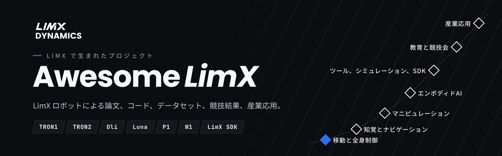

  <a href="README.md">English</a> | <a href="README_cn.md">中文</a> | <b>日本語</b> | <a href="README_ko.md">한국어</a>

  
  
  

> LimX のロボットと LimX SDK にまつわる **159** プロジェクト・提携を収録しています。うち **108** 件はオープンソースコードあり。論文、コード、データセット、チュートリアル、競技会の結果、産業応用を扱います。LimX 公式のオープンソースは [GitHub](https://github.com/limxdynamics) と [Hugging Face](https://huggingface.co/limxdynamics) をご覧ください。

**機種から探す**

| [**TRON1**](robots/TRON1_ja.md) | [**TRON2**](robots/TRON2_ja.md) | [**Oli**](robots/Oli_ja.md) | [**Luna**](robots/Luna_ja.md) | [**P1**](robots/P1_ja.md) | [**W1**](robots/W1_ja.md) |
|:---:|:---:|:---:|:---:|:---:|:---:|
| 92&nbsp;件 | 35&nbsp;件 | 29&nbsp;件 | 7&nbsp;件 | 5&nbsp;件 | 4&nbsp;件 |

## 目次

- [はじめる前に](#はじめる前に)
- [移動と全身制御](#移動と全身制御) — 51
  - [地形と知覚ロコモーション](#地形と知覚ロコモーション)
  - [強化学習の訓練と実機転移](#強化学習の訓練と実機転移)
  - [モデルベース制御](#モデルベース制御)
  - [モーショントラッキングとリターゲティング](#モーショントラッキングとリターゲティング)
- [知覚とナビゲーション](#知覚とナビゲーション) — 14
- [マニピュレーション](#マニピュレーション) — 12
- [エンボディドAI](#エンボディドai) — 9
- [ツール、シミュレーション、SDK](#ツールシミュレーションsdk) — 24
  - [学習フレームワーク](#学習フレームワーク)
  - [シミュレーションと環境](#シミュレーションと環境)
  - [デプロイと制御](#デプロイと制御)
  - [モデルとモーションデータ](#モデルとモーションデータ)
- [教育と競技会](#教育と競技会) — 18
- [産業応用](#産業応用) — 31
  - [導入事例と製品](#導入事例と製品)
  - [企業のオープンソース](#企業のオープンソース)
  - [商業公演とイベント](#商業公演とイベント)
  - [戦略提携](#戦略提携)
  - [地域パートナーと販売チャネル](#地域パートナーと販売チャネル)
  - [受賞と評価](#受賞と評価)
- [機種別](#機種別)
- [コントリビュート](#コントリビュート)

**コード** すぐ動かせる · **チュートリアル** 手順に沿って学べる · **論文** 読むもの · **報道** メディア報道や発表 · *sim* シミュレーションでのみ示された成果、それ以外は実機で動作

## はじめる前に

以下の成果はすべて同じ 4 ステップの上に成り立っています。初めての方は順番に進めてください。ここに挙げたのは LimX 公式のリポジトリで、コミュニティのプロジェクトではありません。

| ステップ | 必要なもの | 入手先 |
|---|---|---|
| 1 · モデル | ロボットの URDF、MJCF、USD | [TRON1](https://github.com/limxdynamics/tron1-robot-description) · [TRON2](https://github.com/limxdynamics/tron2-robot-description) · [Oli](https://github.com/limxdynamics/humanoid-description) · [Luna](https://github.com/limxdynamics/luna-description) |
| 2 · インターフェース | 低レベル運動 SDK、ROS 2 | [limxsdk-lowlevel](https://github.com/limxdynamics/limxsdk-lowlevel) |
| 3 · 学習 | Isaac Lab、Isaac Gym、MuJoCo | [tron1-rl-isaaclab](https://github.com/limxdynamics/tron1-rl-isaaclab) · [tron2_rl_lab](https://github.com/limxdynamics/tron2_rl_lab) · [tron1-mujoco-sim](https://github.com/limxdynamics/tron1-mujoco-sim) |
| 4 · デプロイ | ONNX ランタイム、ROS 2、C++ | [tron1-rl-deploy-python](https://github.com/limxdynamics/tron1-rl-deploy-python) · [humanoid-rl-deploy-python](https://github.com/limxdynamics/humanoid-rl-deploy-python) |

**LimX のロボットで何か作りましたか？** このリストに追加できます —— [プロジェクトを投稿](https://github.com/limxdynamics/awesome-limx/issues/new?template=add-project.yml)（リンクだけで構いません）。先に[コントリビューションガイド](CONTRIBUTING.md)を読むこともできます。コードはご自身のリポジトリのままで構いません。

## 移動と全身制御

_51 件（4 グループ）：論文 20 · コード 31_

### 地形と知覚ロコモーション

| プロジェクト | 機種 | 作者 / 組織 | 年 | 種別 | リンク |
|---|---|---|---|---|---|
| **AME-2**：俊敏な知覚ロコモーション | `TRON1` | [ETH Zurich RSL](https://rsl.ethz.ch) | 2026 | 論文 | [プロジェクト](https://sites.google.com/leggedrobotics.com/ame-2)&nbsp;·&nbsp;[論文](https://arxiv.org/abs/2601.08485) |
| **FastStair**：階段の駆け上がり | `Oli` | HIT, LimX et al. | 2026 | 論文 | [プロジェクト](https://npcliu.github.io/FastStair)&nbsp;·&nbsp;[論文](https://arxiv.org/abs/2601.10365)&nbsp;·&nbsp;[動画](https://youtu.be/SoLBK7VEGDo) |
| **SteppingStoneLocomotion**：飛び石歩行、まずブラインドで、次に視覚あり | `TRON1`&nbsp;*sim* | [Yiyou6](https://github.com/Yiyou6) | 2026 | コード | [コード](https://github.com/Yiyou6/SteppingStoneLocomotion)&nbsp;·&nbsp;[動画](https://www.youtube.com/watch?v=vs608-L7kl0) |
| **Height-Adjustable Wheel-Legged RL**：ホイールフット TRON1 での地形適応と車高調整 | `TRON1` | 桂林電子科技大学、上海交通大学、浙江大学 | 2026 | 論文 | [論文](https://doi.org/10.1109/amc67705.2026.11435832) |
| **Reference-Guided Stair Climbing**：参照軌道に導かれた強化学習でホイールフット TRON1 が階段を走破、学士論文 | `TRON1`&nbsp;*sim* | ウプサラ大学 | 2026 | 論文 | [論文](http://urn.kb.se/resolve?urn=urn:nbn:se:uu:diva-594330) |
| **AME Locomotion for TRON2A**：Isaac Lab での AME 再現に TRON2A 脚式環境を追加 | `TRON2`&nbsp;*sim* | [possibleustc](https://github.com/possibleustc) | 2026 | コード | [コード](https://github.com/possibleustc/AME_Locomotion) |
| **Offline Visual Encoder for Biped Locomotion**：オフライン学習した深度→高さエンコーダによる視覚歩行、TRON1 実機で検証 | `TRON1` | 華中科技大学 | 2026 | 論文 | [論文](https://doi.org/10.1109/access.2026.3686506) |
| **BarlowWalk**：地形適応ロコモーション | `TRON1`&nbsp;*sim* | HIT Shenzhen | 2025 | 論文 | [論文](https://arxiv.org/abs/2508.00939) |
| **CTBC**：車輪でのブラインド階段昇降 | `TRON1` | Shanghai University, COWAROBOT | 2025 | 論文 | [プロジェクト](https://ctbc-for-wheeled-bipedal-robots.github.io/)&nbsp;·&nbsp;[論文](https://arxiv.org/abs/2509.02986) |
| **GA-PHL**：歩容適応型の知覚歩行 | `Oli` | USTC, LimX et al. | 2025 | 論文 | [プロジェクト](https://ga-phl.github.io/)&nbsp;·&nbsp;[論文](https://arxiv.org/abs/2512.07464) |
| **LIPM-Guided RL**：安定した知覚二足歩行 | `TRON1` | SUSTech CLEAR Lab, HKUST et al. | 2025 | 論文 | [論文](https://arxiv.org/abs/2509.09106) |
| **VMTS**：視覚支援による多地形歩行 | `P1` | Southeast University | 2025 | コード | [論文](https://arxiv.org/abs/2503.07049)&nbsp;·&nbsp;[コード](https://github.com/chenfu-user/VMTS) |

### 強化学習の訓練と実機転移

| プロジェクト | 機種 | 作者 / 組織 | 年 | 種別 | リンク |
|---|---|---|---|---|---|
| **Biped RL with Pathfinding**：経路探索付きの目標条件付き学習 | `TRON1`&nbsp;*sim* | [shandilya1998](https://github.com/shandilya1998) | 2026 | コード | [コード](https://github.com/singhaman1750/biped-rl-isaaclab-iisc) |
| **OSRAM**：オンライン sim-to-real 適応 | `TRON1` | [Duke University](https://github.com/generalroboticslab) | 2026 | コード | [コード](https://github.com/generalroboticslab/OSRAM) |
| **rl-tron1**：教師・生徒方式の Isaac Lab 学習 | `TRON1`&nbsp;*sim* | [Jiakang Ma](https://github.com/Jiakang-Ma) | 2026 | コード | [コード](https://github.com/Jiakang-Ma/rl-tron1) |
| **TRON1 Sliding Analysis**：ホイールフットのドリフトと摩擦転移 | `TRON1`&nbsp;*sim* | [Shukashuki](https://github.com/Shukashuki) | 2026 | コード | [コード](https://github.com/Shukashuki/tron1-sliding-analysis) |
| **VAPS**：安全なアクロバット、実機での側宙 | `Oli` | TU Darmstadt, LimX et al. | 2026 | 論文 | [プロジェクト](https://vaps-r-al.github.io/)&nbsp;·&nbsp;[論文](https://arxiv.org/abs/2610.01397) |
| **WF_TRON1A Stand-Still Policy**：その場で静止立ちする RL ポリシー | `TRON1`&nbsp;*sim* | [F-Morry](https://github.com/F-Morry) | 2026 | コード | [コード](https://github.com/F-Morry/limx_rl) |
| **Where-to-Learn**：勾配誘導型の RL 探索 | `TRON1` | ZJU, SUSTech | 2026 | 論文 | [プロジェクト](https://wheretolearn.github.io)&nbsp;·&nbsp;[論文](https://arxiv.org/abs/2603.27317)&nbsp;·&nbsp;[動画](https://www.youtube.com/watch?v=DztdUyh_LVk) |
| **Zetin TRON1 Deploy**：sim-to-sim と実機へのデプロイ | `TRON1` | [Chanjun Lee (UOS Zetin)](https://github.com/chanjun-nyam) | 2026 | コード | [コード](https://github.com/chanjun-nyam/Zetin-Humanoid-RL-Deploy) |
| **SF_TRON Ext Estimator**：ソールフット TRON1 の深度残差ポリシーに履歴ベースの外乱推定器を追加 | `TRON1`&nbsp;*sim* | [EVENWaterOne](https://github.com/EVENWaterOne) | 2026 | コード | [コード](https://github.com/EVENWaterOne/SF_TRON_Ext-estimator) |
| **imfs**：世界モデルで足置き位置を計画し、ソールフット TRON1 が追従（Isaac Gym） | `TRON1`&nbsp;*sim* | [Fleming-Sung](https://github.com/Fleming-Sung) | 2026 | コード | [コード](https://github.com/Fleming-Sung/imfs) |
| **Shape Your Body**：50 種の脚式ロボットで価値勾配による設計探索、TRON1 を含む | `TRON1`&nbsp;*sim* | [nico-bohlinger](https://github.com/nico-bohlinger) | 2026 | コード | [コード](https://github.com/nico-bohlinger/shape-your-body) |
| **Model-Based Gait Planning RL**：3D-LIPM の参照歩容で強化学習の歩容報酬を置き換え、TRON1 実機に展開 | `TRON1` | ハルビン工業大学 | 2026 | 論文 | [論文](https://doi.org/10.1016/j.birob.2026.100338) |
| **W1 Parkour in legged_gym**：legged_gym で W1 ホイール脚四足のパルクールと追従環境を構築、ROS コントローラ付き | `W1`&nbsp;*sim* | [yiqiuqwq](https://github.com/yiqiuqwq) | 2026 | コード | [コード](https://github.com/yiqiuqwq/wheellegged_control) |
| **HIM-PIM Isaac Lab**：HIM と PIM によるロバストなロコモーション | `TRON1`&nbsp;*sim* | [DongyangLin](https://github.com/DongyangLin) | 2025 | コード | [コード](https://github.com/DongyangLin/HIM-PIM-isaaclab) |
| **LeggedRobotsLab**：Go1 と TRON1A 向け Isaac Lab ロコモーション | `TRON1`&nbsp;*sim* | [Guohua Zhang](https://github.com/guohua-zhang) | 2025 | コード | [コード](https://github.com/guohua-zhang/LeggedRobotsLab) |
| **Multi-Loco**：ポイントフットとホイールフットを一つの拡散ポリシーで | `TRON1` | SUSTech CLEAR Lab, LimX et al. | 2025 | コード | [プロジェクト](https://multi-loco.github.io)&nbsp;·&nbsp;[論文](https://arxiv.org/abs/2506.11470)&nbsp;·&nbsp;[コード](https://github.com/clearlab-sustech/multi_loco_isaacgym) |
| **PvP**：データ効率の高いヒューマノイド RL | `Oli` | PolyU, USTC et al. | 2025 | 論文 | [論文](https://arxiv.org/abs/2512.13093) |
| **TRON Camp Wheel-Foot Deployment**：ホイールフットポリシーの実機デプロイ | `TRON1` | [Yitao Zeng](https://github.com/24zen0) | 2025 | コード | [コード](https://github.com/24zen0/Deployment_of_wheelfoot_tron) |
| **PTRL**：ロボット間で事前知識を転移して RL 学習時間を短縮、Go2 と TRON1 で実機検証 | `TRON1` | ハルビン工業大学（深圳）、蘇州大学 | 2025 | 論文 | [論文](https://arxiv.org/abs/2504.05629) |
| **AnyBipe**：LLM が導く二足ロボットの学習とデプロイ | `TRON1` | [SJTU](https://github.com/sjtu-mvasl-robotics) | 2024 | コード | [コード](https://github.com/sjtu-mvasl-robotics/AnyBipe) |
| **CTS**：同時進行型の教師・生徒 RL | `P1` | SUSTech CLEAR Lab, ZJU-UIUC et al. | 2024 | 論文 | [プロジェクト](https://clearlab-sustech.github.io/concurrentTS/)&nbsp;·&nbsp;[論文](https://arxiv.org/abs/2405.10830) |

### モデルベース制御

| プロジェクト | 機種 | 作者 / 組織 | 年 | 種別 | リンク |
|---|---|---|---|---|---|
| **Learning-Enhanced PMP-MPC**：ポイントフット二足向けの学習残差付き MPC | `TRON1`&nbsp;*sim* | [Markwcl2004](https://github.com/Markwcl2004) | 2026 | コード | [論文](https://doi.org/10.1109/ASCC70886.2026.11701800)&nbsp;·&nbsp;[コード](https://github.com/Markwcl2004/PMP_based_Bipedal_MPC) |
| **Whole-Body Humanoid MPC**：31 自由度 Oli での非線形全身 MPC | `Oli`&nbsp;*sim* | [Tianxing Liu](https://github.com/liuskywalkerjskd) | 2026 | コード | [コード](https://github.com/liuskywalkerjskd/humanoid_mpc) |
| **Terrain-Aware CFR Planning**：凸実行可能領域による階段走破計画、W1 で 200 回中 200 回成功 | `W1` | SUSTech CLEAR Lab | 2026 | 論文 | [論文](https://doi.org/10.21203/rs.3.rs-10577407/v1) |
| **Power-Bounded Inverted Pendulum**：二足ロボットの最高速度解析モデル、TRON1 の関節モーターパラメータ最適化に適用 | `TRON1`&nbsp;*sim* | 浙江大学 | 2026 | 論文 | [論文](https://doi.org/10.1007/s10409-026-25928-x) |
| **Hierarchical NMPC + STSMC**：階層型非線形 MPC とスーパーツイスティング・スライディングモード制御、不確かさのあるホイールフット TRON1 向け | `TRON1`&nbsp;*sim* | [pjmcconnellogue](https://github.com/pjmcconnellogue) | 2026 | コード | [コード](https://github.com/pjmcconnellogue/Hierarchical-Nonlinear-MPC-and-Super-Twisting-Sliding-Mode-Control-for-a-Wheeled-Biped-Robot-) |
| **Two-Wheeled Robot LQR**：ホイールフット TRON1 の LQR と全身制御、卒業研究プロジェクト | `TRON1`&nbsp;*sim* | [alpttex19](https://github.com/alpttex19) | 2025 | コード | [コード](https://github.com/alpttex19/Two_Wheeled_Robot_LQR) |
| **Bipedal MPC**：MuJoCo での凸 MPC と WBC | `TRON1`&nbsp;*sim* | [SUSTech CLEAR Lab](https://github.com/clearlab-sustech) | 2024 | コード | [コード](https://github.com/clearlab-sustech/Bipedal_MPC) |
| **Task-Space Riccati WBC**：全身制御 | `P1`&nbsp;*sim* | SUSTech, HKUST et al. | 2024 | 論文 | [論文](https://arxiv.org/abs/2404.00591) |

### モーショントラッキングとリターゲティング

| プロジェクト | 機種 | 作者 / 組織 | 年 | 種別 | リンク |
|---|---|---|---|---|---|
| **Any2Any**：機体をまたぐ全身モーショントラッキング | `Oli` `Luna` | LimX | 2026 | コード | [論文](https://arxiv.org/abs/2605.23733)&nbsp;·&nbsp;[コード](https://github.com/Ming827/any2any_sonic2Oli) |
| **CHIP for Oli**：mjlab での適応コンプライアンス型モーショントラッキング | `Oli`&nbsp;*sim* | [Matt14-mander](https://github.com/Matt14-mander) | 2026 | コード | [コード](https://github.com/Matt14-mander/chip-oli) |
| **SuperMimic for Oli**：一つのポリシーで 40 種類の動作を追従 | `Oli`&nbsp;*sim* | [Tianxing Liu](https://github.com/liuskywalkerjskd) | 2026 | コード | [コード](https://github.com/liuskywalkerjskd/supermimic_oli) |
| **TRON1 WF Mimic**：ダンス模倣と実現可能性の検証 | `TRON1`&nbsp;*sim* | [HUST-dolores](https://github.com/HUST-dolores) | 2026 | コード | [コード](https://github.com/HUST-dolores/tron1-wf-mimic) |
| **robot_lab_srl**：robot_lab 拡張、Oli のモーション模倣タスクを追加（Isaac Lab） | `Oli`&nbsp;*sim* | [song-hl](https://github.com/song-hl) | 2026 | コード | [コード](https://github.com/song-hl/robot_lab_srl) |
| **robot_retargeter**：SMPL-X や他ロボットのモーションをヒューマノイドへリターゲット、Oli 設定を同梱 | `Oli`&nbsp;*sim* | [ccrpRepo](https://github.com/ccrpRepo) | 2026 | コード | [コード](https://github.com/ccrpRepo/robot_retargeter) |
| **Timo**：テキストから動作を生成する運動学を考慮したマルチモーダル拡散 Transformer、生成動作を Oli と Luna の実機で実行 | `Oli` `Luna` | LimX Dynamics | 2026 | 論文 | [プロジェクト](https://kyfafyd.wang/projects/timo)&nbsp;·&nbsp;[論文](https://arxiv.org/abs/2609.30761) |
| **HU_D03 RL in mjlab**：mjlab で旧型 Oli（HU_D03）の歩行と動作模倣ポリシーを学習（ベトナム語） | `Oli`&nbsp;*sim* | [KhanhPham248](https://github.com/KhanhPham248) | 2026 | コード | [コード](https://github.com/KhanhPham248/LimX_HU_D03_rl_mjlab) |
| **robodance**：ウェブのダンス動画を Oli を含む 12 機種のヒューマノイドにリターゲット、MuJoCo で描画 | `Oli`&nbsp;*sim* | [junyuan-fang](https://github.com/junyuan-fang) | 2026 | コード | [コード](https://github.com/junyuan-fang/robodance) |
| **Multi-Embodiment Retargeting**：拡散モデルによるモーションリターゲティング | `TRON1` `Oli`&nbsp;*sim* | SUSTech, HKUST et al. | 2025 | 論文 | [論文](https://arxiv.org/abs/2505.20857) |

## 知覚とナビゲーション

_14 件：論文 3 · コード 11_

| プロジェクト | 機種 | 作者 / 組織 | 年 | 種別 | リンク |
|---|---|---|---|---|---|
| **tron1_navrl**：Isaac Lab での強化学習ローカルナビゲーション（韓国語） | `TRON1`&nbsp;*sim* | [jongbob1918](https://github.com/jongbob1918) | 2026 | コード | [コード](https://github.com/jongbob1918/tron1_navrl) |
| **TRON1 Multi-floor Navigation**：平地走行、フロア切り替え、階段走行を一つのミッションに統合（韓国語） | `TRON1` | [justpastmarch](https://github.com/justpastmarch) | 2026 | コード | [コード](https://github.com/justpastmarch/TRON1_multifloor-navigation) |
| **Geometric Candidate Modes**：マルチモーダルなデモからナビゲーションを学習、シミュレーションで学習したポリシーを TRON1 に転移 | `TRON1` | オハイオ州立大学 | 2026 | 論文 | [論文](https://arxiv.org/abs/2610.20241) |
| **ros2_gnss_waypoint_nav**：RTK GNSS、MID360、Nav2 による地図不要の屋外ウェイポイントナビゲーション、TRON1 ベースブリッジ付き | `TRON1` | [武漢大学 BRAIN Lab](https://github.com/Whu-BrainLab) | 2026 | コード | [コード](https://github.com/Whu-BrainLab/ros2_gnss_waypoint_nav) |
| **LightNav-0**：VLM ベースのナビゲーションスタック、MPC 追従と Web パネル付き、Go2 と TRON1 に対応 | `TRON1` | [Light Origins](https://github.com/lightorigins) | 2026 | コード | [論文](https://arxiv.org/abs/2608.30935)&nbsp;·&nbsp;[コード](https://github.com/lightorigins/LightNav-0)&nbsp;·&nbsp;[モデル](https://huggingface.co/LightOriginsHQ/LightNav-0) |
| **GPS-TRON1**：FAST-LIO を使った屋外 GPS ナビゲーション | `TRON1` | [potatoHu-a](https://github.com/potatoHu-a) | 2026 | コード | [コード](https://github.com/potatoHu-a/GPS-TRON1) |
| **WF_TRON1A LiDAR Navigation**：LiDAR オドメトリとナビゲーション | `TRON1` | [F-Morry](https://github.com/F-Morry) | 2026 | コード | [コード](https://github.com/F-Morry/limx_ws) |
| **WAVE-Go**：世界モデルによる行動適応で長距離ナビゲーション、Go2-W 実機と MuJoCo 上の Luna で検証 | `Luna`&nbsp;*sim* | BIT、HKU、LimX ほか | 2026 | コード | [論文](https://arxiv.org/abs/2609.18193)&nbsp;·&nbsp;[コード](https://github.com/vigorlee/wave-go) |
| **Hourglass**：機体に依存しない世界モデルによるクロスエンボディメント動作計画、訓練用 7 機種に TRON1 | `TRON1`&nbsp;*sim* | 南洋理工大学 | 2026 | 論文 | [論文](https://arxiv.org/abs/2610.41330) |
| **TRON-1 Struzzo**：Jetson による自律ナビゲーション | `TRON1` | [enfff](https://github.com/enfff) | 2025 | コード | [コード](https://github.com/enfff/tron1-gazebo-ros2) |
| **NeuPAN on TRON1**：車輪形態でのエンドツーエンド NeuPAN ナビゲーション | `TRON1` | [WikHClean](https://github.com/WikHClean) | 2025 | コード | [コード](https://github.com/WikHClean/-ROS1-NeuPAN-TRON1-) |
| **3D Navigation with PCT Planner**：階段での 3D ナビゲーション | `TRON1` | [81578823](https://github.com/81578823) | 2025 | コード | [コード](https://github.com/81578823/3D_navigation_PCTplanner) |
| **Terrain-Aware LiDAR-Inertial Odometry**：地形を考慮した脚車輪ロボット向け LiDAR 慣性オドメトリ、ホイールフット TRON1 で屋外実験 | `TRON1` | 上海交通大学 | 2025 | 論文 | [論文](https://arxiv.org/abs/2509.26222) |
| **EROAM**：イベントカメラによる回転オドメトリ、TRON1 で収録したシーケンスを含む | `TRON1` | [wlxing1901](https://github.com/wlxing1901) | 2024 | コード | [プロジェクト](https://wlxing1901.github.io/eroam/)&nbsp;·&nbsp;[論文](https://arxiv.org/abs/2411.11004)&nbsp;·&nbsp;[コード](https://github.com/wlxing1901/eroam)&nbsp;·&nbsp;[動画](https://youtu.be/8tF6b2VuvSM) |

## マニピュレーション

_12 件：論文 5 · コード 7_

| プロジェクト | 機種 | 作者 / 組織 | 年 | 種別 | リンク |
|---|---|---|---|---|---|
| **COLA on TRON2**：人とロボットの協調搬送、TRON2 への移植 | `TRON2`&nbsp;*sim* | [Matt14-mander](https://github.com/Matt14-mander) | 2026 | コード | [コード](https://github.com/Matt14-mander/COLA_TRON2) |
| **Holistic Loco-Manipulation**：アーム付き TRON1 | `TRON1` | ZJU-UIUC, LimX | 2026 | 論文 | [論文](https://arxiv.org/abs/2609.18930) |
| **TRON1-to-UR5e Bottle Transfer**：ROS 2 と MuJoCo | `TRON1`&nbsp;*sim* | [Centaucyan](https://github.com/Centaucyan) | 2026 | コード | [コード](https://github.com/Centaucyan/Proj_Transferring_bottle_from_tron1_to_ur5e_in_mujoco_env) |
| **Cooperative Transportation**：2 台のホイール脚ロボットで荷物を運搬 | `TRON1` `TRON2`&nbsp;*sim* | [Matt14-mander](https://github.com/Matt14-mander) | 2026 | コード | [コード](https://github.com/Matt14-mander/Multiple_Humanoid_Cooperative_Transportation) |
| **CWI**：ロコマニピュレーションのための全身模倣 | `Oli` | LimX, HKU et al. | 2026 | 論文 | [プロジェクト](https://cwi-ral.github.io/CWI-RAL-Webpage/)&nbsp;·&nbsp;[論文](https://arxiv.org/abs/2606.27676) |
| **Arm-TRON**：アーム付きの再構成可能な二足ロボット | `TRON1` | SUSTech, ZJU et al. | 2026 | 論文 | [論文](https://doi.org/10.1109/TMECH.2026.3727546) |
| **TRON2 Cooperative Carrying**：2 台の TRON2 による協調搬送の研究基盤、MuJoCo と LimX SDK インターフェース | `TRON2`&nbsp;*sim* | [Matt14-mander](https://github.com/Matt14-mander) | 2026 | コード | [コード](https://github.com/Matt14-mander/tron2-cooperative-carrying) |
| **Mobile Pedipulation**：階層型 NMPC でホイールフット TRON1 が車輪付きの脚で物体を押し動かす、RA-L | `TRON1` | ミシガン大学 | 2026 | 論文 | [論文](https://arxiv.org/abs/2606.19233) |
| **TRON2 Vision Teleoperation**：OAK-D で腕と手を追跡して双腕 TRON2 を遠隔操作、ORCA ハンドと Elecnor ブランドの配管ドリル作業シーン付き（スペイン語） | `TRON2`&nbsp;*sim* | [Aremanky](https://github.com/Aremanky) | 2026 | コード | [コード](https://github.com/Aremanky/Teleoperacion-tron-2) |
| **UMI on Tron1**：実機 TRON1 で ARX5 アームによる UMI スキル | `TRON1` | [Czy213hd](https://github.com/Czy213hd) | 2025 | コード | [コード](https://github.com/Czy213hd/umi-on-tron-lab) |
| **Quest VR Teleop for Oli**：Meta Quest による腕と頭の遠隔操作 | `Oli` | [MSTLE](https://github.com/MSTLE) | 2025 | コード | [コード](https://github.com/MSTLE/Limx_teleoperate-end_pose) |
| **Wheeled-Quadrupedal Manipulator**：アーム付き W1、姿勢追従 | `W1` | SUSTech CLEAR Lab, ZJU-UIUC et al. | 2024 | 論文 | [プロジェクト](https://clearlab-sustech.github.io/RFM_loco_mani/)&nbsp;·&nbsp;[論文](https://arxiv.org/abs/2412.03012) |

## エンボディドAI

_9 件：論文 2 · コード 7_

| プロジェクト | 機種 | 作者 / 組織 | 年 | 種別 | リンク |
|---|---|---|---|---|---|
| **Tron 1 Hermes Agent**：Mac 上の MuJoCo で TRON1 を動かす自己改善型ローカル AI エージェント | `TRON1`&nbsp;*sim* | [justinsuo](https://github.com/justinsuo) | 2026 | コード | [コード](https://github.com/justinsuo/tron1-hermes-agent) |
| **FluxVLA on TRON2**：自分の TRON2 で FluxVLA を学習・デプロイ | `TRON2` | [emoPointer](https://github.com/emoPointer) | 2026 | コード | [コード](https://github.com/emoPointer/FluxVLA) |
| **Oli Voice Interaction**：音声対話と動作制御 | `Oli` | [zhilin2025](https://github.com/zhilin2025) | 2026 | コード | [コード](https://github.com/zhilin2025/oli_audio) |
| **HWAM**：ヒューマノイド世界行動モデル | `Oli` | LimX | 2026 | 論文 | [プロジェクト](https://hwam.vercel.app/)&nbsp;·&nbsp;[論文](https://arxiv.org/abs/2610.12026) |
| **ACG-WAM**：多指ハンド付きの世界行動モデル | `TRON2` | BIT, LimX | 2026 | コード | [プロジェクト](https://RoboOpus.github.io/ACG-WAM)&nbsp;·&nbsp;[論文](https://arxiv.org/abs/2610.06965)&nbsp;·&nbsp;[コード](https://github.com/RoboOpus/ACG-WAM) |
| **GR00T Drifting Heads**：1 ステップのアクションヘッド | `TRON2` | ZJU-UIUC, LimX | 2026 | 論文 | [論文](https://arxiv.org/abs/2609.18108) |
| **TRON2 Garment Feeder**：Pi0.5 ポリシー | `TRON2` | [voniu](https://huggingface.co/voniu) | 2026 | コード | [モデル](https://huggingface.co/voniu/tron2-garment-feeder-button-pi05) |
| **TRON2 LeRobot Datasets**：データセットと GR00T ファインチューニングモデル | `TRON2` | [trantor2nd](https://huggingface.co/trantor2nd) | 2026 | コード | [モデル](https://huggingface.co/models?author=trantor2nd&search=tron2)&nbsp;·&nbsp;[データセット](https://huggingface.co/datasets?author=trantor2nd&search=tron2) |
| **TRONCamp Pi0.5 Policies**：TRON2 の生け花・布たたみ向け Pi0.5 チェックポイント | `TRON2` | [toki1231](https://huggingface.co/toki1231) | 2026 | コード | [モデル](https://huggingface.co/toki1231) |

## ツール、シミュレーション、SDK

_ツール 24 件（4 グループ）_

### 学習フレームワーク

| プロジェクト | 機種 | 作者 / 組織 | 年 | リンク |
|---|---|---|---|---|
| **TRON1 Isaac Lab Tasks**：3 種類の足すべてに対応した Isaac Lab タスク、ジャンプを含む | `TRON1` | [HughWang-wzy](https://github.com/HughWang-wzy) | 2026 | [コード](https://github.com/HughWang-wzy/tron1-rl-isaaclab) |
| **tron1-rl-mjlab**：mjlab でのホイールフット学習 | `TRON1` | [Xinchen Yao](https://github.com/hoscy) | 2025 | [コード](https://github.com/hoscy/tron1-rl-mjlab) |
| **LeggedGym-Ex**：Genesis、Isaac Gym、Isaac Sim 上の legged_gym | `TRON1` | [Yasen Jia](https://github.com/lupinjia) | 2024 | [コード](https://github.com/lupinjia/LeggedGym-Ex) |
| **bipedal_locomotion_isaaclab**：Isaac Lab 学習と実機転移 | `TRON1` | [Andy-xiong6 (SUSTech)](https://github.com/Andy-xiong6) | 2024 | [コード](https://github.com/Andy-xiong6/bipedal_locomotion_isaaclab) |

### シミュレーションと環境

| プロジェクト | 機種 | 作者 / 組織 | 年 | リンク |
|---|---|---|---|---|
| **tron2-wuji-bag-replay**：TRON2 と Wuji ハンドの軌道を Isaac Sim で再生 | `TRON2` | [zengxiong111](https://github.com/zengxiong111) | 2026 | [コード](https://github.com/zengxiong111/tron2-wuji-bag-replay) |
| **MetalSim**：TRON1 シーン付きの Apple シリコン向けシミュレータ | `TRON1` | [Aditya Pulipaka](https://github.com/pulipakaa24) | 2026 | [コード](https://github.com/pulipakaa24/MetalSim) |
| **robot-sim-docker**：LimX 向け Gazebo、Isaac Lab、MuJoCo コンテナ | `TRON1` | [Aklva](https://github.com/Aklva) | 2026 | [コード](https://github.com/Aklva/robot-sim-docker) |
| **limx-robotics-mcp**：シミュレーションと制御のための MCP サーバー | `TRON1` `Oli` | [sandraschi](https://github.com/sandraschi) | 2026 | [コード](https://github.com/sandraschi/limx-robotics-mcp) |
| **tron_docker_sim**：Gazebo シミュレーション用 Docker イメージ | `TRON1` | [The-RoboTUM](https://github.com/The-RoboTUM) | 2026 | [コード](https://github.com/The-RoboTUM/tron_docker_sim) |
| **roqsim**：プラグイン式 MuJoCo シミュレーション基盤、同梱ヒューマノイドに Oli | `Oli` | [cps-test-lab](https://github.com/cps-test-lab) | 2026 | [コード](https://github.com/cps-test-lab/roqsim) |
| **Gewu (Unity RL Playground)**：国家地方共建ヒューマノイドロボットイノベーションセンター、上海大学、清華大学による Unity 学習プラットフォーム、TRON1 の歩行・走行・ジャンプポリシーを同梱 | `TRON1` | [loongOpen](https://github.com/loongOpen) | 2025 | [論文](https://arxiv.org/abs/2503.05146)&nbsp;·&nbsp;[コード](https://github.com/loongOpen/Unity-RL-Playground) |
| **ARC Bridge**：TRON1 向けコントローラーと MuJoCo のブリッジ | `TRON1` | [UMich ARCaD Lab](https://github.com/ARCaD-Lab-UM) | 2024 | [コード](https://github.com/ARCaD-Lab-UM/arc-bridge) |

### デプロイと制御

| プロジェクト | 機種 | 作者 / 組織 | 年 | リンク |
|---|---|---|---|---|
| **tron1_ctrl_ros2**：TRON1 の WebSocket SDK をラップした ROS 2 制御パッケージ | `TRON1` | [Turing-zero](https://github.com/Turing-zero) | 2026 | [コード](https://github.com/Turing-zero/tron1_ctrl_ros2) |
| **tron2_camera_calibration**：TRON2 の頭部・手首カメラのキャリブレーションツール | `TRON2` | [zengxiong111](https://github.com/zengxiong111) | 2026 | [コード](https://github.com/zengxiong111/tron2_camera_calibration) |
| **tron1_wheel_gui**：実機 TRON1 用の Qt 操作パネル | `TRON1` | [Yang Zhuqi](https://github.com/Y20-code-cpu) | 2026 | [コード](https://github.com/Y20-code-cpu/tron1_wheel_gui) |
| **wf_tron1b_deploy**：深度知覚ポリシーの sim-to-sim | `TRON1` | [Leixin Chang](https://github.com/Leixinjonaschang) | 2026 | [コード](https://github.com/Leixinjonaschang/wf_tron1b_deploy) |
| **Tron_Deploy**：Windows からポリシーをデプロイ | `TRON1` | [candi4](https://github.com/candi4) | 2026 | [コード](https://github.com/candi4/Tron_Deploy) |
| **Multi-Robot Camera Collector**：TRON1・TRON2・Bunker 台車のカメラを切り替え、タスク段階ごとに画像を保存してデータ収集（中国語） | `TRON1` `TRON2` | [oalaaCN](https://github.com/oalaaCN) | 2026 | [コード](https://github.com/oalaaCN/multi_robot_camera_collector) |
| **CRL Humanoid ROS**：G1 と TRON1A 向け ROS 2 フレームワーク | `TRON1` | [Jin Cheng (ETH Zurich CRL)](https://github.com/catachiii) | 2025 | [コード](https://github.com/catachiii/crl-humanoid-ros) |
| **websocket_ros**：TRON1 の WebSocket API を ROS につなぐ Docker ブリッジ、実機なしでテストできる疑似ロボット付き | `TRON1` | [daweidavidwang](https://github.com/daweidavidwang) | 2025 | [コード](https://github.com/daweidavidwang/websocket_ros) |

### モデルとモーションデータ

| プロジェクト | 機種 | 作者 / 組織 | 年 | リンク |
|---|---|---|---|---|
| **RIMKit**：接触を考慮したリターゲティング、Oli 対応 | `Oli` | [Taemoon Jeong](https://github.com/tmjeong1103) | 2026 | [コード](https://github.com/tmjeong1103/RIMKit) |
| **tron2_revo3_description**：BrainCo Revo3 ハンド付き TRON2 | `TRON2` | [ENDLESS0321](https://github.com/ENDLESS0321) | 2026 | [コード](https://github.com/ENDLESS0321/tron2_revo3_description) |
| **robot_descriptions.py**：TRON1、TRON2、Oli、Luna のモデルを 1 行で読み込み | `TRON1` `TRON2` `Oli` `Luna` | [robot-descriptions](https://github.com/robot-descriptions) | 2026 | [コード](https://github.com/robot-descriptions/robot_descriptions.py) |
| **limx-3d-measurement-workbench**：TRON モデルの閲覧と寸法計測 | `TRON1` `TRON2` | [voniu](https://github.com/voniu) | 2026 | [コード](https://github.com/voniu/limx-3d-measurement-workbench) |

## 教育と競技会

_18 件：論文 2 · コード 15 · チュートリアル 1_

| プロジェクト | 機種 | 作者 / 組織 | 年 | 種別 | リンク |
|---|---|---|---|---|---|
| **ATEC 2026 Simulation Challenge**：TRON1 と TRON2A 部門のある公式チャレンジ | `TRON1` `TRON2`&nbsp;*sim* | [ATEC](https://github.com/atecup) | 2026 | コード | [コード](https://github.com/atecup/ATEC2026_Simulation_Challenge) |
| **TRONCamp 2026 Mani Solution**：ACT による双腕マニピュレーション | `TRON2`&nbsp;*sim* | [han-xudong](https://github.com/han-xudong) | 2026 | コード | [コード](https://github.com/han-xudong/troncamp-mani)&nbsp;·&nbsp;[モデル](https://huggingface.co/han-xudong/troncamp-mani-act)&nbsp;·&nbsp;[データセット](https://huggingface.co/datasets/han-xudong/troncamp-mani-dataset) |
| **TRONCamp 2026 Locomotion Solution**：SFYG TRON2A の RL ポリシー | `TRON2`&nbsp;*sim* | [han-xudong](https://github.com/han-xudong) | 2026 | コード | [コード](https://github.com/han-xudong/troncamp-locomotion)&nbsp;·&nbsp;[モデル](https://huggingface.co/han-xudong/troncamp-locomotion-rl) |
| **study_tron1**：環境構築メモと学習ログ | `TRON1`&nbsp;*sim* | [beamkeerati](https://github.com/beamkeerati) | 2026 | コード | [コード](https://github.com/beamkeerati/study_tron1) |
| **OpenArm Mobile Manipulation Lab**：TRON1 と OpenArm、LLM によるミッション（韓国語） | `TRON1`&nbsp;*sim* | [aha645](https://github.com/aha645) | 2026 | コード | [コード](https://github.com/aha645/openarms_llm_ex) |
| **LimX Tron1 Learning**：インタラクティブな Isaac Lab ガイド | `TRON1`&nbsp;*sim* | [jessiezhg](https://huggingface.co/jessiezhg) | 2026 | チュートリアル | [チュートリアル](https://huggingface.co/spaces/jessiezhg/LimX-Tron1-Learning) |
| **Zetin RoboCup 2026**：Isaac Lab でソールフット TRON1 のサッカーロボットに歩行・ボール追跡・シュートを学習（韓国語） | `TRON1`&nbsp;*sim* | [tae2yi](https://github.com/tae2yi) | 2026 | コード | [コード](https://github.com/tae2yi/Zetin_Robocup2026) |
| **Conducting Evaluation System**：音楽教育向けの指揮動作の実演と評価システム、Oli のデジタルツインで実証 | `Oli`&nbsp;*sim* | 広東培正学院 | 2026 | 論文 | [論文](https://doi.org/10.1145/3806980.3807204) |
| **Every Embodied: TRONCamp Mani**：Datawhale の具身 AI オープン講座、TRON2 双腕タスクを扱う TRONCamp Mani の章を収録（中国語） | `TRON2`&nbsp;*sim* | [Datawhale](https://github.com/datawhalechina) | 2026 | コード | [コード](https://github.com/datawhalechina/every-embodied/tree/main/15-Challenge%E7%AB%9E%E8%B5%9B/TRONCamp-Mani) |
| **ATEC 2026 Wheel-Legged Entry**：ATEC 2026 チャレンジ参加チームの強化学習訓練とシミュレーション配備 | `TRON1` `TRON2`&nbsp;*sim* | [Logic-TARS](https://github.com/Logic-TARS) | 2026 | コード | [コード](https://github.com/Logic-TARS/ATEC2026) |
| **Zetin RoboCup Control**：RoboCup 2026 の試合用コード：TRON1 の下半身に自作の上半身とカメラを接続（韓国語） | `TRON1` | [newb-ops（ソウル市立大学 ZETIN）](https://github.com/newb-ops) | 2026 | コード | [コード](https://github.com/newb-ops/robocup-control-portfolio) |
| **TRONCamp Mani Solution 24ZlhA**：ACT とハードサンプルマイニング、マルチ GPU 学習、技術レポート付き。T4 のオンライン得点は 79/100 | `TRON2`&nbsp;*sim* | [upset666](https://github.com/upset666) | 2026 | コード | [コード](https://github.com/upset666/troncamp-mani-24ZlhA) |
| **TRONCamp Mani ACT + Diffusion Policy**：T1〜T3 は ACT、3 つのボウルを積む課題は Diffusion Policy、設計文書付き（中国語） | `TRON2`&nbsp;*sim* | [irvingskr](https://github.com/irvingskr) | 2026 | コード | [コード](https://github.com/irvingskr/troncamp-mani) |
| **TRONCamp Mani Solution SORMaker**：4 課題共通の ACT 学習・デプロイ手順、T3・T4 ポリシーの実行動画付き | `TRON2`&nbsp;*sim* | [SORMaker](https://github.com/SORMaker) | 2026 | コード | [コード](https://github.com/SORMaker/troncamp-mani) |
| **Hands-on Embodied AI**：アルゴリズムから実機までの公開講座、ポイントフットとホイールフットの TRON1 で屋外 GNSS と Nav2 ナビゲーション（中国語） | `TRON1` | [武漢大学 BRAIN Lab](https://github.com/Whu-BrainLab) | 2025 | コード | [コード](https://github.com/Whu-BrainLab/Embodied-AI-Tutorial)&nbsp;·&nbsp;[チュートリアル](https://mp.weixin.qq.com/s/YLKVi09hgImSuWUr_S6gJA) |
| **広州タワー ロボット登塔チャレンジ**：優勝と最優秀精密制御賞、FastStair を使用 | `Oli` | LimX | 2025 | 論文 | [論文](https://arxiv.org/abs/2601.10365)&nbsp;·&nbsp;[結果](https://www.sfccn.com/2026/1-1/5NMDE0NzNfMjA5MzM5NA.html) |
| **RL Bipedal Locomotion**：SUSTech ACR2025 の授業プロジェクト | `TRON1`&nbsp;*sim* | [81578823 (SUSTech)](https://github.com/81578823) | 2025 | コード | [コード](https://github.com/81578823/RL_bipedal_locomotion_Isaaclab) |
| **pointfootGym**：Isaac Gym の授業用テンプレート | `TRON1`&nbsp;*sim* | [Haokai Su (SUSTech CLEAR Lab)](https://github.com/SuDaxia-kai) | 2024 | コード | [コード](https://github.com/SuDaxia-kai/pointfootGym) |

## 産業応用

_31 件（6 グループ）_

### 導入事例と製品

| プロジェクト | 機種 | 作者 / 組織 | 年 | 種別 | リンク |
|---|---|---|---|---|---|
| **TENNIIX ULTRA MAX**：TRON2 ホイール脚を土台にしたテニスロボット、2026 ビリー・ジーン・キング・カップ ファイナルでプロと対戦 | `TRON2` | Enhanced Robotics (Tenniix) | 2026 | 報道 | [報道](https://www.news.cn/sports/20260928/f1776d7ca75042568a5137e256fa9425/c.html) |
| **ZINOVA Tool Intelligence**：2 台の TRON2 が釘打ち機と鉄筋で縮小版のティルトアップ工法を実演 | `TRON2` | ZINOVA, RIC Robotics | 2026 | 報道 | [動画](https://www.youtube.com/watch?v=8KDxnT-4zl0)&nbsp;·&nbsp;[報道](https://www.equipmentworld.com/technology/article/15836367/zinova-limx-bring-toolwielding-robots-to-construction) |
| **国産電子アーキテクチャのヒューマノイド**：東土科技の Intewell OS と AUTBUS バスを搭載した Oli、共同発表 | `Oli` | 東土科技（Kyland） | 2026 | 報道 | [報道](http://mp.weixin.qq.com/s?__biz=Mzk0NDU5NjMwMA==&mid=2247495106&idx=1&sn=8b5ffd05d0615a0581d3b23a18f2d830&chksm=c20243eecd5be209a820feecab39fcb0480f5ec903b40f0d655db8f6225b378bd0e8f1db3a1a)&nbsp;·&nbsp;[報道](https://m.21jingji.com/article/20260929/herald/af2d0b02d6e7593ed4a2af7d05a191b5.html) |
| **RDK S100 on TRON1**：ポイントフット TRON1 の運動制御モデルを D-Robotics の RDK S100 の BPU に移植、同ボードの公式応用事例 | `TRON1` | D-Robotics | 2025 | 報道 | [報道](https://forum.d-robotics.cc/t/topic/28833) |

### 企業のオープンソース

| プロジェクト | 機種 | 作者 / 組織 | 年 | 種別 | リンク |
|---|---|---|---|---|---|
| **Xense OpenPI**：TRON2 向けの Pi0.5 学習設定とリアルタイム推論 | `TRON2` | [Xense Robotics](https://github.com/XenseRobotics-AI) | 2026 | コード | [コード](https://github.com/XenseRobotics-AI/xense-openpi) |
| **TRON2 Description, Crest edition**：SFYG アームの手首カメラマウントに合わせて調整した TRON2 モデル | `TRON2` | [Crest Robotics](https://github.com/Crest-Robotics) | 2026 | コード | [コード](https://github.com/Crest-Robotics/tron2-robot-description) |
| **TRON1 Nav2 in Newton**：Newton シミュレータで TRON1 の Nav2 ルートテスト | `TRON1`&nbsp;*sim* | [Artefacts](https://github.com/art-e-fact) | 2026 | コード | [コード](https://github.com/art-e-fact/tron-navigation-demo) |
| **LeRobot Pico4 Teleoperator**：LeRobot 用の PICO 4 双腕遠隔操作プラグイン、TRON2 に対応 | `TRON2` | [Xense Robotics](https://github.com/XenseRobotics-AI) | 2026 | コード | [コード](https://github.com/XenseRobotics-AI/lerobot-teleoperator-pico4) |
| **SONIC Training for HU_D04**：31 自由度の Oli で GEAR-SONIC 全身制御を学習、PICO VR 遠隔操作に対応 | `Oli`&nbsp;*sim* | [SafeSentinel](https://github.com/safe-sentinel-co) | 2026 | コード | [コード](https://github.com/safe-sentinel-co/hu_d04_sonic_setup) |
| **ANIMA ROS 2 Simulation Network**：TRON1 二足モデルを同梱した ROS 2 と Gazebo のシミュレーションスタック | `TRON1`&nbsp;*sim* | [RobotFlow Labs](https://github.com/RobotFlow-Labs) | 2026 | コード | [コード](https://github.com/RobotFlow-Labs/anima-ros2-sim-net) |
| **TRON1 Artefacts Workspace**：Artefacts ロボットテスト基盤を使った ROS 2 と Gazebo のデモ | `TRON1`&nbsp;*sim* | [Artefacts](https://github.com/art-e-fact) | 2026 | コード | [コード](https://github.com/art-e-fact/tron1-artefacts) |
| **OM1-sim**：ロボット OS「OM1」向け Isaac Sim 環境、ホイールフット TRON1・Go2・G1 に対応 | `TRON1`&nbsp;*sim* | [OpenMind](https://github.com/OpenMind) | 2026 | コード | [コード](https://github.com/OpenMind/OM1-sim) |
| **Phanthy Motus Drivers**：4Paradigm の具身 AI 基盤 Phanthy Motus のハードウェアドライバ、TRON2 双腕に対応 | `TRON2` | [4Paradigm](https://github.com/4paradigm) | 2026 | コード | [コード](https://github.com/4paradigm/phanthymotus-driver) |
| **Xense TRON2 Pick-and-Place Dataset**：触覚映像付きの遠隔操作 115 エピソード、Voxel51 が FiftyOne 形式でも公開 | `TRON2` | [Xense Robotics](https://huggingface.co/Xense) | 2026 | コード | [データセット](https://huggingface.co/datasets/Xense/tron2rt-pnp-0918)&nbsp;·&nbsp;[データセット](https://huggingface.co/datasets/Voxel51/xense-tron2rt-pnp-115ep) |
| **ANIMA ROS 2 Bridge**：AI エージェントと ROS 2 ロボットをつなぐ DDS / WebSocket ブリッジ、LimX 機を識別し TRON1 モデルを同梱 | `TRON1`&nbsp;*sim* | [RobotFlow Labs](https://github.com/RobotFlow-Labs) | 2026 | コード | [コード](https://github.com/RobotFlow-Labs/anima-ros2-bridge) |
| **Citadel**：HDF5 の記録を LeRobot v2.1 に一括変換するロボットデータ管理ツール、例に TRON2 のデータを使用 | `TRON2` | [China Merchants Research Institute of Advanced Technology](https://github.com/cmriat) | 2026 | コード | [コード](https://github.com/cmriat/Citadel) |
| **OpenMind BrainPack**：TRON1、Unitree G1、Go2 に対応するモジュール式コンピュート・開発バックパック | `TRON1` | [OpenMind](https://github.com/OpenMind) | 2025 | コード | [コード](https://github.com/OpenMind/brainpack) |

### 商業公演とイベント

| プロジェクト | 機種 | 作者 / 組織 | 年 | 種別 | リンク |
|---|---|---|---|---|---|
| **粤港澳大湾区モーターショー NIO ブース**：NIO ブースで Oli と Luna がインタラクティブなデモ | `Oli` `Luna` | NIO | 2026 | 報道 | [報道](https://news.ifeng.com/c/8vmGa3sP4u7) |
| **「キル・イット」決勝**：デザイナー キム・ナラの優勝決勝ステージに Luna が登場、tvN | `Luna` | tvN、キム・ナラ | 2026 | 報道 | [報道](https://isplus.com/article/view/isp202607290025)&nbsp;·&nbsp;[報道](https://mikekalil.com/blog/the-rise-of-limx-dynamics/) |
| **淘宝インフルエンサーフェスティバル**：上海で俳優 ミシェル・チェンと Luna がランウェイを歩行 | `Luna` | 淘宝 | 2026 | 報道 | [報道](https://mikekalil.com/blog/limx-dynamics-luna-humanoid-robot/) |

### 戦略提携

| プロジェクト | 機種 | 作者 / 組織 | 年 | 種別 | リンク |
|---|---|---|---|---|---|
| **SmartCube**：韓国の公式パートナー、工場やエネルギー施設の点検にヒューマノイドとデジタルツインを活用 | — | SmartCube（韓国） | 2026 | 報道 | [報道](https://www.aipostkorea.com/news/articleView.html?idxno=12727) |
| **光洋股份**：一体型関節モジュールを共同開発、軸受・歯車・減速機・ドライバーを含む（サプライチェーン連携） | — | 光洋股份 | 2026 | 報道 | [報道](https://www.nbd.com.cn/articles/2026-03-09/4285402.html)&nbsp;·&nbsp;[報道](https://finance.eastmoney.com/a/202603093666208673.html) |
| **上汽北京 共同ラボ**：自動車製造向けのエンボディドAI共同ラボ、LimX は SAIC 初のエンボディドAI戦略パートナー | — | 上汽北京 | 2025 | 報道 | [報道](https://www.pingwest.com/a/306356) |

### 地域パートナーと販売チャネル

| プロジェクト | 機種 | 作者 / 組織 | 年 | 種別 | リンク |
|---|---|---|---|---|---|
| **Knoxlabs**：米国で TRON2 と Oli のバンドルを販売、データ収集向け遠隔操作のセットアップを提供 | `TRON2` `Oli` | Knoxlabs | 2026 | 報道 | [報道](https://www.knoxlabs.com/blogs/articles/robot-teleoperation-data-collection-limx) |
| **トロン株式会社**：日本でヒューマノイドのシステムインテグレーションと Omniverse シミュレーションを提供、LimX を取り扱い | — | トロン株式会社 | 2026 | 報道 | [報道](https://tron.tokyo/en/service/limx-dynamics/) |
| **ロボットバンク**：TRON1、TRON2、Oli を日本国内で展開、現場導入を支援 | `TRON1` `TRON2` `Oli` | ロボットバンク | 2026 | 報道 | [報道](https://robotstart.info/article/2026/05/15/381891.html) |
| **MYBOTSHOP**：ドイツで P1 を販売・サポート、ユーザーマニュアル、ネットワークと ROS 2 の設定ガイド、修理受付を提供 | `P1` | MYBOTSHOP GmbH（ドイツ） | 2026 | 報道 | [報道](https://www.docs.mybotshop.de/limx_p1.html) |
| **Synerex**：韓国の公式パートナー、Drone Show Korea 2025 で TRON1 を韓国初公開 | `TRON1` | Synerex（韓国） | 2025 | 報道 | [報道](https://www.newswire.co.kr/newsRead.php?no=1005949) |
| **R2C2**：香港の公式デベロッパー兼販売代理店、強化学習ロボットを公共設備と点検業務に活用 | `W1` `P1` | R2C2 Limited（香港） | 2024 | 報道 | [報道](https://www.linkedin.com/posts/limx-dynamics_robotics-partnership-innovation-activity-7211709457666310145-ddt9) |

### 受賞と評価

| プロジェクト | 機種 | 作者 / 組織 | 年 | 種別 | リンク |
|---|---|---|---|---|---|
| **IEEE Spectrum Robot of the Month**：TRON1 が IEEE Spectrum 誌の「Robot of the Month」に掲載 | `TRON1` | IEEE Spectrum | 2026 | 報道 | [報道](https://doi.org/10.1109/MSPEC.2026.11595926) |
| **RBR50 ロボティクス・イノベーション・アワード 2025**：TRON1 がマルチモーダル二足の研究開発プラットフォームとして選出 | `TRON1` | The Robot Report | 2025 | 報道 | [結果](https://www.therobotreport.com/rbr50-company-2025/tron-1-multi-modal-biped-offers-a-unique-rd-platform/) |

## 機種別

機種ごとに専用ページがあり、その機種を使った項目をすべてまとめています： [TRON1](robots/TRON1_ja.md) · [TRON2](robots/TRON2_ja.md) · [Oli](robots/Oli_ja.md) · [Luna](robots/Luna_ja.md) · [P1](robots/P1_ja.md) · [W1](robots/W1_ja.md)

機種ごと・カテゴリごとの掲載数：

| 機種 | 合計 | 移動 | 知覚 | マニピュレーション | エンボディドAI | ツール | 教育 | 産業 |
|---|---:|---:|---:|---:|---:|---:|---:|---:|
| [`TRON1`](robots/TRON1_ja.md) | **92** | 32 | 13 | 6 | 1 | 19 | 10 | 11 |
| [`TRON2`](robots/TRON2_ja.md) | **35** | 1 |  | 4 | 6 | 6 | 8 | 10 |
| [`Oli`](robots/Oli_ja.md) | **29** | 14 |  | 2 | 2 | 4 | 2 | 5 |
| [`Luna`](robots/Luna_ja.md) | **7** | 2 | 1 |  |  | 1 |  | 3 |
| [`P1`](robots/P1_ja.md) | **5** | 3 |  |  |  |  |  | 2 |
| [`W1`](robots/W1_ja.md) | **4** | 2 |  | 1 |  |  |  | 1 |

## コントリビュート

自薦も他薦も歓迎します。[投稿フォーム](https://github.com/limxdynamics/awesome-limx/issues/new?template=add-project.yml)、Pull Request、またはメール [opensource@limxdynamics.com](mailto:opensource@limxdynamics.com) でお送りください。英語・中国語・日本語・韓国語のどれでも構いません。収録基準は [CONTRIBUTING.md](CONTRIBUTING.md) をご覧ください。各カテゴリは新しい順に並んでいます。「種別」列は読者が得られるものを示します：すぐ動かせるもの（**コード**）、手順に沿って学べるもの（**チュートリアル**）、読むもの（**論文**）。

掲載は LimX による推奨を意味するものではなく、権利はすべて原作者に帰属します。掲載の取り下げは、理由を問わずいつでも依頼できます。

提携・購入のお問い合わせは [opensource@limxdynamics.com](mailto:opensource@limxdynamics.com) まで。

## ライセンス

このリストは [CC0 1.0](LICENSE) で公開しています。リンク先のプロジェクトにはそれぞれのライセンスが適用されます。
