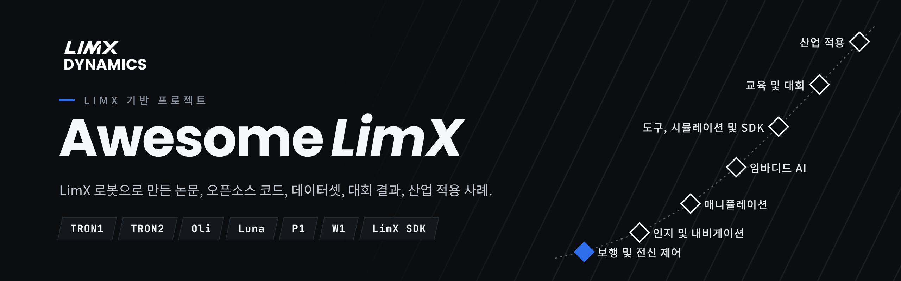

  <a href="README.md">English</a> | <a href="README_cn.md">中文</a> | <a href="README_ja.md">日本語</a> | <b>한국어</b>

  
  
  

> LimX 로봇과 LimX SDK 관련 **154**개 프로젝트와 협력 사례를 모았고, 그중 **104**개는 오픈소스 코드를 제공합니다. 논문, 코드, 데이터셋, 튜토리얼, 대회 결과, 산업 적용 사례를 다룹니다. LimX 공식 오픈소스는 [GitHub](https://github.com/limxdynamics)와 [Hugging Face](https://huggingface.co/limxdynamics)에서 확인하세요.

**기종별로 찾기**

| [**TRON1**](robots/TRON1_ko.md) | [**TRON2**](robots/TRON2_ko.md) | [**Oli**](robots/Oli_ko.md) | [**Luna**](robots/Luna_ko.md) | [**P1**](robots/P1_ko.md) | [**W1**](robots/W1_ko.md) |
|:---:|:---:|:---:|:---:|:---:|:---:|
| 90개 | 31개 | 29개 | 7개 | 5개 | 4개 |

## 목차

- [시작하기 전에](#시작하기-전에)
- [보행 및 전신 제어](#보행-및-전신-제어) — 51
  - [지형 및 인지 기반 보행](#지형-및-인지-기반-보행)
  - [강화학습 훈련 및 실기 전이](#강화학습-훈련-및-실기-전이)
  - [모델 기반 제어](#모델-기반-제어)
  - [모션 트래킹 및 리타게팅](#모션-트래킹-및-리타게팅)
- [인지 및 내비게이션](#인지-및-내비게이션) — 13
- [매니퓰레이션](#매니퓰레이션) — 11
- [임바디드 AI](#임바디드-ai) — 9
- [도구, 시뮬레이션 및 SDK](#도구-시뮬레이션-및-sdk) — 23
  - [학습 프레임워크](#학습-프레임워크)
  - [시뮬레이션 및 환경](#시뮬레이션-및-환경)
  - [배포 및 제어](#배포-및-제어)
  - [모델 및 모션 데이터](#모델-및-모션-데이터)
- [교육 및 대회](#교육-및-대회) — 17
- [산업 적용](#산업-적용) — 30
  - [적용 사례 및 제품](#적용-사례-및-제품)
  - [기업 오픈소스](#기업-오픈소스)
  - [상업 공연 및 이벤트](#상업-공연-및-이벤트)
  - [전략적 제휴](#전략적-제휴)
  - [지역 파트너 및 판매 채널](#지역-파트너-및-판매-채널)
  - [수상 및 인정](#수상-및-인정)
- [기종별](#기종별)
- [기여하기](#기여하기)

**코드** 바로 실행 가능 · **튜토리얼** 따라 배울 수 있음 · **논문** 읽을거리 · **보도** 언론 보도나 발표 · *sim* 시뮬레이션에서만 보여준 성과, 나머지는 실제 로봇에서 동작

## 시작하기 전에

아래의 모든 성과는 같은 네 단계를 바탕으로 합니다. 처음이라면 순서대로 따라가세요. 여기 있는 것은 LimX 공식 저장소이며 커뮤니티 프로젝트가 아닙니다.

| 단계 | 필요한 것 | 받는 곳 |
|---|---|---|
| 1 · 모델 | 로봇의 URDF, MJCF, USD | [TRON1](https://github.com/limxdynamics/tron1-robot-description) · [TRON2](https://github.com/limxdynamics/tron2-robot-description) · [Oli](https://github.com/limxdynamics/humanoid-description) · [Luna](https://github.com/limxdynamics/luna-description) |
| 2 · 인터페이스 | 저수준 모션 SDK, ROS 2 | [limxsdk-lowlevel](https://github.com/limxdynamics/limxsdk-lowlevel) |
| 3 · 학습 | Isaac Lab, Isaac Gym, MuJoCo | [tron1-rl-isaaclab](https://github.com/limxdynamics/tron1-rl-isaaclab) · [tron2_rl_lab](https://github.com/limxdynamics/tron2_rl_lab) · [tron1-mujoco-sim](https://github.com/limxdynamics/tron1-mujoco-sim) |
| 4 · 배포 | ONNX 런타임, ROS 2, C++ | [tron1-rl-deploy-python](https://github.com/limxdynamics/tron1-rl-deploy-python) · [humanoid-rl-deploy-python](https://github.com/limxdynamics/humanoid-rl-deploy-python) |

**LimX 로봇으로 무언가 만들었나요?** 이 목록에 추가할 수 있습니다 —— [프로젝트 제출](https://github.com/limxdynamics/awesome-limx/issues/new?template=add-project.yml)(링크만 있으면 됩니다). 먼저 [기여 안내](CONTRIBUTING.md)를 읽어도 좋습니다. 코드는 원래 저장소에 그대로 두시면 됩니다.

## 보행 및 전신 제어

_51개 (4개 그룹): 논문 20 · 코드 31_

### 지형 및 인지 기반 보행

| 프로젝트 | 기종 | 저자 / 기관 | 연도 | 유형 | 링크 |
|---|---|---|---|---|---|
| **AME-2**: 민첩한 인지 기반 보행 | `TRON1` | [ETH Zurich RSL](https://rsl.ethz.ch) | 2026 | 논문 | [프로젝트](https://sites.google.com/leggedrobotics.com/ame-2)&nbsp;·&nbsp;[논문](https://arxiv.org/abs/2601.08485) |
| **FastStair**: 계단 달려 오르기 | `Oli` | HIT, LimX et al. | 2026 | 논문 | [프로젝트](https://npcliu.github.io/FastStair)&nbsp;·&nbsp;[논문](https://arxiv.org/abs/2601.10365)&nbsp;·&nbsp;[영상](https://youtu.be/SoLBK7VEGDo) |
| **SteppingStoneLocomotion**: 징검다리 보행, 블라인드 후 비전 적용 | `TRON1`&nbsp;*sim* | [Yiyou6](https://github.com/Yiyou6) | 2026 | 코드 | [코드](https://github.com/Yiyou6/SteppingStoneLocomotion)&nbsp;·&nbsp;[영상](https://www.youtube.com/watch?v=vs608-L7kl0) |
| **Height-Adjustable Wheel-Legged RL**: 휠풋 TRON1의 지형 적응과 차체 높이 조절 | `TRON1` | 구이린전자과기대, 상하이교통대, 저장대 | 2026 | 논문 | [논문](https://doi.org/10.1109/amc67705.2026.11435832) |
| **Reference-Guided Stair Climbing**: 참조 궤적 유도 강화학습으로 휠풋 TRON1 계단 주행, 학사 논문 | `TRON1`&nbsp;*sim* | 웁살라 대학교 | 2026 | 논문 | [논문](http://urn.kb.se/resolve?urn=urn:nbn:se:uu:diva-594330) |
| **AME Locomotion for TRON2A**: Isaac Lab AME 재현에 TRON2A 족형 환경 추가 | `TRON2`&nbsp;*sim* | [possibleustc](https://github.com/possibleustc) | 2026 | 코드 | [코드](https://github.com/possibleustc/AME_Locomotion) |
| **Offline Visual Encoder for Biped Locomotion**: 오프라인 학습한 깊이→높이 인코더 기반 시각 보행, TRON1 실기 검증 | `TRON1` | 화중과기대학교 | 2026 | 논문 | [논문](https://doi.org/10.1109/access.2026.3686506) |
| **BarlowWalk**: 지형 적응 보행 | `TRON1`&nbsp;*sim* | HIT Shenzhen | 2025 | 논문 | [논문](https://arxiv.org/abs/2508.00939) |
| **CTBC**: 바퀴로 하는 블라인드 계단 오르기 | `TRON1` | Shanghai University, COWAROBOT | 2025 | 논문 | [프로젝트](https://ctbc-for-wheeled-bipedal-robots.github.io/)&nbsp;·&nbsp;[논문](https://arxiv.org/abs/2509.02986) |
| **GA-PHL**: 보행 패턴 적응형 인지 보행 | `Oli` | USTC, LimX et al. | 2025 | 논문 | [프로젝트](https://ga-phl.github.io/)&nbsp;·&nbsp;[논문](https://arxiv.org/abs/2512.07464) |
| **LIPM-Guided RL**: 안정적인 인지 기반 이족 보행 | `TRON1` | SUSTech CLEAR Lab, HKUST et al. | 2025 | 논문 | [논문](https://arxiv.org/abs/2509.09106) |
| **VMTS**: 비전 보조 다지형 보행 | `P1` | Southeast University | 2025 | 코드 | [논문](https://arxiv.org/abs/2503.07049)&nbsp;·&nbsp;[코드](https://github.com/chenfu-user/VMTS) |

### 강화학습 훈련 및 실기 전이

| 프로젝트 | 기종 | 저자 / 기관 | 연도 | 유형 | 링크 |
|---|---|---|---|---|---|
| **Biped RL with Pathfinding**: 경로 탐색을 결합한 목표 조건부 학습 | `TRON1`&nbsp;*sim* | [shandilya1998](https://github.com/shandilya1998) | 2026 | 코드 | [코드](https://github.com/singhaman1750/biped-rl-isaaclab-iisc) |
| **OSRAM**: 온라인 sim-to-real 적응 | `TRON1` | [Duke University](https://github.com/generalroboticslab) | 2026 | 코드 | [코드](https://github.com/generalroboticslab/OSRAM) |
| **rl-tron1**: 교사-학생 방식 Isaac Lab 학습 | `TRON1`&nbsp;*sim* | [Jiakang Ma](https://github.com/Jiakang-Ma) | 2026 | 코드 | [코드](https://github.com/Jiakang-Ma/rl-tron1) |
| **TRON1 Sliding Analysis**: 휠-풋 미끄러짐과 마찰 전이 | `TRON1`&nbsp;*sim* | [Shukashuki](https://github.com/Shukashuki) | 2026 | 코드 | [코드](https://github.com/Shukashuki/tron1-sliding-analysis) |
| **VAPS**: 안전한 곡예 동작, 실기 옆돌기 | `Oli` | TU Darmstadt, LimX et al. | 2026 | 논문 | [프로젝트](https://vaps-r-al.github.io/)&nbsp;·&nbsp;[논문](https://arxiv.org/abs/2610.01397) |
| **WF_TRON1A Stand-Still Policy**: 제자리 정지 서기 RL 정책 | `TRON1`&nbsp;*sim* | [F-Morry](https://github.com/F-Morry) | 2026 | 코드 | [코드](https://github.com/F-Morry/limx_rl) |
| **Where-to-Learn**: 그래디언트 유도 RL 탐색 | `TRON1` | ZJU, SUSTech | 2026 | 논문 | [프로젝트](https://wheretolearn.github.io)&nbsp;·&nbsp;[논문](https://arxiv.org/abs/2603.27317)&nbsp;·&nbsp;[영상](https://www.youtube.com/watch?v=DztdUyh_LVk) |
| **Zetin TRON1 Deploy**: sim-to-sim 및 실기 배포 | `TRON1` | [Chanjun Lee (UOS Zetin)](https://github.com/chanjun-nyam) | 2026 | 코드 | [코드](https://github.com/chanjun-nyam/Zetin-Humanoid-RL-Deploy) |
| **SF_TRON Ext Estimator**: 솔풋 TRON1의 깊이 잔차 정책에 이력 기반 외란 추정기 추가 | `TRON1`&nbsp;*sim* | [EVENWaterOne](https://github.com/EVENWaterOne) | 2026 | 코드 | [코드](https://github.com/EVENWaterOne/SF_TRON_Ext-estimator) |
| **imfs**: 월드 모델로 발 디딤 위치를 계획하고 솔풋 TRON1이 추종 (Isaac Gym) | `TRON1`&nbsp;*sim* | [Fleming-Sung](https://github.com/Fleming-Sung) | 2026 | 코드 | [코드](https://github.com/Fleming-Sung/imfs) |
| **Shape Your Body**: 족형 로봇 50종에 대한 가치 기울기 설계 탐색, TRON1 포함 | `TRON1`&nbsp;*sim* | [nico-bohlinger](https://github.com/nico-bohlinger) | 2026 | 코드 | [코드](https://github.com/nico-bohlinger/shape-your-body) |
| **Model-Based Gait Planning RL**: 3D-LIPM 참조 보행으로 강화학습 보행 보상을 대체, TRON1 실기 배포 | `TRON1` | 하얼빈 공업대학교 | 2026 | 논문 | [논문](https://doi.org/10.1016/j.birob.2026.100338) |
| **W1 Parkour in legged_gym**: legged_gym에서 W1 휠-레그 사족용 파쿠르·추종 환경 구축, ROS 컨트롤러 포함 | `W1`&nbsp;*sim* | [yiqiuqwq](https://github.com/yiqiuqwq) | 2026 | 코드 | [코드](https://github.com/yiqiuqwq/wheellegged_control) |
| **HIM-PIM Isaac Lab**: HIM과 PIM을 이용한 강건한 보행 | `TRON1`&nbsp;*sim* | [DongyangLin](https://github.com/DongyangLin) | 2025 | 코드 | [코드](https://github.com/DongyangLin/HIM-PIM-isaaclab) |
| **LeggedRobotsLab**: Go1과 TRON1A용 Isaac Lab 보행 | `TRON1`&nbsp;*sim* | [Guohua Zhang](https://github.com/guohua-zhang) | 2025 | 코드 | [코드](https://github.com/guohua-zhang/LeggedRobotsLab) |
| **Multi-Loco**: 포인트풋과 휠풋을 하나의 확산 정책으로 | `TRON1` | SUSTech CLEAR Lab, LimX et al. | 2025 | 코드 | [프로젝트](https://multi-loco.github.io)&nbsp;·&nbsp;[논문](https://arxiv.org/abs/2506.11470)&nbsp;·&nbsp;[코드](https://github.com/clearlab-sustech/multi_loco_isaacgym) |
| **PvP**: 데이터 효율적인 휴머노이드 RL | `Oli` | PolyU, USTC et al. | 2025 | 논문 | [논문](https://arxiv.org/abs/2512.13093) |
| **TRON Camp Wheel-Foot Deployment**: 휠풋 정책 실기 배포 | `TRON1` | [Yitao Zeng](https://github.com/24zen0) | 2025 | 코드 | [코드](https://github.com/24zen0/Deployment_of_wheelfoot_tron) |
| **PTRL**: 로봇 간 사전 지식 전이로 RL 학습 시간 단축, Go2와 TRON1에서 실기 검증 | `TRON1` | 하얼빈공대(선전), 쑤저우대 | 2025 | 논문 | [논문](https://arxiv.org/abs/2504.05629) |
| **AnyBipe**: LLM 기반 이족 로봇 학습 및 배포 | `TRON1` | [SJTU](https://github.com/sjtu-mvasl-robotics) | 2024 | 코드 | [코드](https://github.com/sjtu-mvasl-robotics/AnyBipe) |
| **CTS**: 동시 교사-학생 RL | `P1` | SUSTech CLEAR Lab, ZJU-UIUC et al. | 2024 | 논문 | [프로젝트](https://clearlab-sustech.github.io/concurrentTS/)&nbsp;·&nbsp;[논문](https://arxiv.org/abs/2405.10830) |

### 모델 기반 제어

| 프로젝트 | 기종 | 저자 / 기관 | 연도 | 유형 | 링크 |
|---|---|---|---|---|---|
| **Learning-Enhanced PMP-MPC**: 포인트풋 이족 로봇용 학습 잔차 MPC | `TRON1`&nbsp;*sim* | [Markwcl2004](https://github.com/Markwcl2004) | 2026 | 코드 | [논문](https://doi.org/10.1109/ASCC70886.2026.11701800)&nbsp;·&nbsp;[코드](https://github.com/Markwcl2004/PMP_based_Bipedal_MPC) |
| **Whole-Body Humanoid MPC**: 31자유도 Oli 비선형 전신 MPC | `Oli`&nbsp;*sim* | [Tianxing Liu](https://github.com/liuskywalkerjskd) | 2026 | 코드 | [코드](https://github.com/liuskywalkerjskd/humanoid_mpc) |
| **Terrain-Aware CFR Planning**: 볼록 가능 영역 기반 계단 주행 계획, W1에서 200회 중 200회 성공 | `W1` | SUSTech CLEAR Lab | 2026 | 논문 | [논문](https://doi.org/10.21203/rs.3.rs-10577407/v1) |
| **Power-Bounded Inverted Pendulum**: 이족 로봇 최고 속도 분석 모델, TRON1 관절 모터 파라미터 최적화에 적용 | `TRON1`&nbsp;*sim* | 저장대학교 | 2026 | 논문 | [논문](https://doi.org/10.1007/s10409-026-25928-x) |
| **Hierarchical NMPC + STSMC**: 계층형 비선형 MPC와 슈퍼 트위스팅 슬라이딩 모드 제어, 불확실성 하의 휠풋 TRON1 | `TRON1`&nbsp;*sim* | [pjmcconnellogue](https://github.com/pjmcconnellogue) | 2026 | 코드 | [코드](https://github.com/pjmcconnellogue/Hierarchical-Nonlinear-MPC-and-Super-Twisting-Sliding-Mode-Control-for-a-Wheeled-Biped-Robot-) |
| **Two-Wheeled Robot LQR**: 휠풋 TRON1의 LQR 및 전신 제어, 졸업 논문 프로젝트 | `TRON1`&nbsp;*sim* | [alpttex19](https://github.com/alpttex19) | 2025 | 코드 | [코드](https://github.com/alpttex19/Two_Wheeled_Robot_LQR) |
| **Bipedal MPC**: MuJoCo 기반 볼록 MPC와 WBC | `TRON1`&nbsp;*sim* | [SUSTech CLEAR Lab](https://github.com/clearlab-sustech) | 2024 | 코드 | [코드](https://github.com/clearlab-sustech/Bipedal_MPC) |
| **Task-Space Riccati WBC**: 전신 제어 | `P1`&nbsp;*sim* | SUSTech, HKUST et al. | 2024 | 논문 | [논문](https://arxiv.org/abs/2404.00591) |

### 모션 트래킹 및 리타게팅

| 프로젝트 | 기종 | 저자 / 기관 | 연도 | 유형 | 링크 |
|---|---|---|---|---|---|
| **Any2Any**: 기체 간 전신 모션 트래킹 | `Oli` `Luna` | LimX | 2026 | 코드 | [논문](https://arxiv.org/abs/2605.23733)&nbsp;·&nbsp;[코드](https://github.com/Ming827/any2any_sonic2Oli) |
| **CHIP for Oli**: mjlab 기반 적응형 컴플라이언스 모션 트래킹 | `Oli`&nbsp;*sim* | [Matt14-mander](https://github.com/Matt14-mander) | 2026 | 코드 | [코드](https://github.com/Matt14-mander/chip-oli) |
| **SuperMimic for Oli**: 하나의 정책으로 40개 동작 추종 | `Oli`&nbsp;*sim* | [Tianxing Liu](https://github.com/liuskywalkerjskd) | 2026 | 코드 | [코드](https://github.com/liuskywalkerjskd/supermimic_oli) |
| **TRON1 WF Mimic**: 댄스 모방과 실현 가능성 연구 | `TRON1`&nbsp;*sim* | [HUST-dolores](https://github.com/HUST-dolores) | 2026 | 코드 | [코드](https://github.com/HUST-dolores/tron1-wf-mimic) |
| **robot_lab_srl**: robot_lab 확장, Oli 모션 모방 태스크 추가 (Isaac Lab) | `Oli`&nbsp;*sim* | [song-hl](https://github.com/song-hl) | 2026 | 코드 | [코드](https://github.com/song-hl/robot_lab_srl) |
| **robot_retargeter**: SMPL-X 또는 다른 로봇의 모션을 휴머노이드로 리타게팅, Oli 설정 포함 | `Oli`&nbsp;*sim* | [ccrpRepo](https://github.com/ccrpRepo) | 2026 | 코드 | [코드](https://github.com/ccrpRepo/robot_retargeter) |
| **Timo**: 텍스트-투-모션용 운동학 인지 멀티모달 확산 트랜스포머, 생성 동작을 리타게팅해 Oli와 Luna 실기에서 실행 | `Oli` `Luna` | LimX Dynamics | 2026 | 논문 | [프로젝트](https://kyfafyd.wang/projects/timo)&nbsp;·&nbsp;[논문](https://arxiv.org/abs/2609.30761) |
| **HU_D03 RL in mjlab**: mjlab에서 이전 세대 Oli(HU_D03)의 보행·동작 모방 정책 학습 (베트남어) | `Oli`&nbsp;*sim* | [KhanhPham248](https://github.com/KhanhPham248) | 2026 | 코드 | [코드](https://github.com/KhanhPham248/LimX_HU_D03_rl_mjlab) |
| **robodance**: 웹 댄스 영상을 Oli를 포함한 휴머노이드 12종에 리타게팅, MuJoCo로 렌더링 | `Oli`&nbsp;*sim* | [junyuan-fang](https://github.com/junyuan-fang) | 2026 | 코드 | [코드](https://github.com/junyuan-fang/robodance) |
| **Multi-Embodiment Retargeting**: 확산 모델 기반 모션 리타게팅 | `TRON1` `Oli`&nbsp;*sim* | SUSTech, HKUST et al. | 2025 | 논문 | [논문](https://arxiv.org/abs/2505.20857) |

## 인지 및 내비게이션

_13개: 논문 2 · 코드 11_

| 프로젝트 | 기종 | 저자 / 기관 | 연도 | 유형 | 링크 |
|---|---|---|---|---|---|
| **tron1_navrl**: Isaac Lab 기반 강화학습 로컬 내비게이션 (한국어) | `TRON1`&nbsp;*sim* | [jongbob1918](https://github.com/jongbob1918) | 2026 | 코드 | [코드](https://github.com/jongbob1918/tron1_navrl) |
| **TRON1 Multi-floor Navigation**: 평면 주행, 층 전환, 계단 주행을 하나의 미션으로 운영 (한국어) | `TRON1` | [justpastmarch](https://github.com/justpastmarch) | 2026 | 코드 | [코드](https://github.com/justpastmarch/TRON1_multifloor-navigation) |
| **Geometric Candidate Modes**: 멀티모달 시연으로 내비게이션 학습, 시뮬레이션에서 학습한 정책을 TRON1에 전이 | `TRON1` | 오하이오 주립대학교 | 2026 | 논문 | [논문](https://arxiv.org/abs/2610.20241) |
| **ros2_gnss_waypoint_nav**: RTK GNSS, MID360, Nav2 기반 지도 없는 실외 웨이포인트 내비게이션, TRON1 베이스 브리지 포함 | `TRON1` | [우한대학교 BRAIN Lab](https://github.com/Whu-BrainLab) | 2026 | 코드 | [코드](https://github.com/Whu-BrainLab/ros2_gnss_waypoint_nav) |
| **LightNav-0**: VLM 기반 내비게이션 스택, MPC 추종과 웹 패널 포함, Go2와 TRON1 지원 | `TRON1` | [Light Origins](https://github.com/lightorigins) | 2026 | 코드 | [논문](https://arxiv.org/abs/2608.30935)&nbsp;·&nbsp;[코드](https://github.com/lightorigins/LightNav-0)&nbsp;·&nbsp;[모델](https://huggingface.co/LightOriginsHQ/LightNav-0) |
| **GPS-TRON1**: FAST-LIO 기반 실외 GPS 내비게이션 | `TRON1` | [potatoHu-a](https://github.com/potatoHu-a) | 2026 | 코드 | [코드](https://github.com/potatoHu-a/GPS-TRON1) |
| **WF_TRON1A LiDAR Navigation**: LiDAR 오도메트리와 내비게이션 | `TRON1` | [F-Morry](https://github.com/F-Morry) | 2026 | 코드 | [코드](https://github.com/F-Morry/limx_ws) |
| **WAVE-Go**: 월드 모델 행동 적응 기반 장거리 내비게이션, Go2-W 실기와 MuJoCo의 Luna로 검증 | `Luna`&nbsp;*sim* | BIT, HKU, LimX 외 | 2026 | 코드 | [논문](https://arxiv.org/abs/2609.18193)&nbsp;·&nbsp;[코드](https://github.com/vigorlee/wave-go) |
| **Hourglass**: 몸체 무관 월드 모델 기반 교차 구현체 모션 플래닝, 학습 로봇 7종에 TRON1 포함 | `TRON1`&nbsp;*sim* | 난양공과대학교 | 2026 | 논문 | [논문](https://arxiv.org/abs/2610.41330) |
| **TRON-1 Struzzo**: Jetson 기반 자율 내비게이션 | `TRON1` | [enfff](https://github.com/enfff) | 2025 | 코드 | [코드](https://github.com/enfff/tron1-gazebo-ros2) |
| **NeuPAN on TRON1**: 바퀴 형태의 엔드투엔드 NeuPAN 내비게이션 | `TRON1` | [WikHClean](https://github.com/WikHClean) | 2025 | 코드 | [코드](https://github.com/WikHClean/-ROS1-NeuPAN-TRON1-) |
| **3D Navigation with PCT Planner**: 계단에서의 3D 내비게이션 | `TRON1` | [81578823](https://github.com/81578823) | 2025 | 코드 | [코드](https://github.com/81578823/3D_navigation_PCTplanner) |
| **EROAM**: 이벤트 카메라 회전 오도메트리, TRON1에서 수집한 시퀀스 포함 | `TRON1` | [wlxing1901](https://github.com/wlxing1901) | 2024 | 코드 | [프로젝트](https://wlxing1901.github.io/eroam/)&nbsp;·&nbsp;[논문](https://arxiv.org/abs/2411.11004)&nbsp;·&nbsp;[코드](https://github.com/wlxing1901/eroam)&nbsp;·&nbsp;[영상](https://youtu.be/8tF6b2VuvSM) |

## 매니퓰레이션

_11개: 논문 5 · 코드 6_

| 프로젝트 | 기종 | 저자 / 기관 | 연도 | 유형 | 링크 |
|---|---|---|---|---|---|
| **COLA on TRON2**: 사람-로봇 협동 운반, TRON2 이식 | `TRON2`&nbsp;*sim* | [Matt14-mander](https://github.com/Matt14-mander) | 2026 | 코드 | [코드](https://github.com/Matt14-mander/COLA_TRON2) |
| **Holistic Loco-Manipulation**: 로봇팔을 단 TRON1 | `TRON1` | ZJU-UIUC, LimX | 2026 | 논문 | [논문](https://arxiv.org/abs/2609.18930) |
| **TRON1-to-UR5e Bottle Transfer**: ROS 2와 MuJoCo | `TRON1`&nbsp;*sim* | [Centaucyan](https://github.com/Centaucyan) | 2026 | 코드 | [코드](https://github.com/Centaucyan/Proj_Transferring_bottle_from_tron1_to_ur5e_in_mujoco_env) |
| **Cooperative Transportation**: 휠-레그 로봇 두 대가 짐을 운반 | `TRON1` `TRON2`&nbsp;*sim* | [Matt14-mander](https://github.com/Matt14-mander) | 2026 | 코드 | [코드](https://github.com/Matt14-mander/Multiple_Humanoid_Cooperative_Transportation) |
| **CWI**: 로코-매니퓰레이션을 위한 전신 모방 | `Oli` | LimX, HKU et al. | 2026 | 논문 | [프로젝트](https://cwi-ral.github.io/CWI-RAL-Webpage/)&nbsp;·&nbsp;[논문](https://arxiv.org/abs/2606.27676) |
| **Arm-TRON**: 로봇팔을 단 재구성형 이족 로봇 | `TRON1` | SUSTech, ZJU et al. | 2026 | 논문 | [논문](https://doi.org/10.1109/TMECH.2026.3727546) |
| **TRON2 Cooperative Carrying**: TRON2 두 대의 협동 운반 연구 플랫폼, MuJoCo와 LimX SDK 인터페이스 | `TRON2`&nbsp;*sim* | [Matt14-mander](https://github.com/Matt14-mander) | 2026 | 코드 | [코드](https://github.com/Matt14-mander/tron2-cooperative-carrying) |
| **Mobile Pedipulation**: 계층형 NMPC로 휠풋 TRON1이 바퀴 달린 다리로 물체를 밀어 옮김, RA-L | `TRON1` | 미시간 대학교 | 2026 | 논문 | [논문](https://arxiv.org/abs/2606.19233) |
| **UMI on Tron1**: 실기 TRON1에서 ARX5 팔로 UMI 스킬 수행 | `TRON1` | [Czy213hd](https://github.com/Czy213hd) | 2025 | 코드 | [코드](https://github.com/Czy213hd/umi-on-tron-lab) |
| **Quest VR Teleop for Oli**: Meta Quest로 팔과 머리 원격 조종 | `Oli` | [MSTLE](https://github.com/MSTLE) | 2025 | 코드 | [코드](https://github.com/MSTLE/Limx_teleoperate-end_pose) |
| **Wheeled-Quadrupedal Manipulator**: 로봇팔을 단 W1, 자세 추종 | `W1` | SUSTech CLEAR Lab, ZJU-UIUC et al. | 2024 | 논문 | [프로젝트](https://clearlab-sustech.github.io/RFM_loco_mani/)&nbsp;·&nbsp;[논문](https://arxiv.org/abs/2412.03012) |

## 임바디드 AI

_9개: 논문 2 · 코드 7_

| 프로젝트 | 기종 | 저자 / 기관 | 연도 | 유형 | 링크 |
|---|---|---|---|---|---|
| **Tron 1 Hermes Agent**: Mac의 MuJoCo에서 TRON1을 구동하는 자기 개선형 로컬 AI 에이전트 | `TRON1`&nbsp;*sim* | [justinsuo](https://github.com/justinsuo) | 2026 | 코드 | [코드](https://github.com/justinsuo/tron1-hermes-agent) |
| **FluxVLA on TRON2**: 내 TRON2에서 FluxVLA 학습 및 배포 | `TRON2` | [emoPointer](https://github.com/emoPointer) | 2026 | 코드 | [코드](https://github.com/emoPointer/FluxVLA) |
| **Oli Voice Interaction**: 음성 대화와 동작 제어 | `Oli` | [zhilin2025](https://github.com/zhilin2025) | 2026 | 코드 | [코드](https://github.com/zhilin2025/oli_audio) |
| **HWAM**: 휴머노이드 월드 액션 모델 | `Oli` | LimX | 2026 | 논문 | [프로젝트](https://hwam.vercel.app/)&nbsp;·&nbsp;[논문](https://arxiv.org/abs/2610.12026) |
| **ACG-WAM**: 다관절 손을 쓰는 월드 액션 모델 | `TRON2` | BIT, LimX | 2026 | 코드 | [프로젝트](https://RoboOpus.github.io/ACG-WAM)&nbsp;·&nbsp;[논문](https://arxiv.org/abs/2610.06965)&nbsp;·&nbsp;[코드](https://github.com/RoboOpus/ACG-WAM) |
| **GR00T Drifting Heads**: 원스텝 액션 헤드 | `TRON2` | ZJU-UIUC, LimX | 2026 | 논문 | [논문](https://arxiv.org/abs/2609.18108) |
| **TRON2 Garment Feeder**: Pi0.5 정책 | `TRON2` | [voniu](https://huggingface.co/voniu) | 2026 | 코드 | [모델](https://huggingface.co/voniu/tron2-garment-feeder-button-pi05) |
| **TRON2 LeRobot Datasets**: 데이터셋과 GR00T 파인튜닝 모델 | `TRON2` | [trantor2nd](https://huggingface.co/trantor2nd) | 2026 | 코드 | [모델](https://huggingface.co/models?author=trantor2nd&search=tron2)&nbsp;·&nbsp;[데이터셋](https://huggingface.co/datasets?author=trantor2nd&search=tron2) |
| **TRONCamp Pi0.5 Policies**: TRON2 꽃꽂이·옷 개기용 Pi0.5 체크포인트 | `TRON2` | [toki1231](https://huggingface.co/toki1231) | 2026 | 코드 | [모델](https://huggingface.co/toki1231) |

## 도구, 시뮬레이션 및 SDK

_도구 23개 (4개 그룹)_

### 학습 프레임워크

| 프로젝트 | 기종 | 저자 / 기관 | 연도 | 링크 |
|---|---|---|---|---|
| **TRON1 Isaac Lab Tasks**: 세 가지 발 형태 전부를 위한 Isaac Lab 태스크, 점프 포함 | `TRON1` | [HughWang-wzy](https://github.com/HughWang-wzy) | 2026 | [코드](https://github.com/HughWang-wzy/tron1-rl-isaaclab) |
| **tron1-rl-mjlab**: mjlab 기반 휠풋 학습 | `TRON1` | [Xinchen Yao](https://github.com/hoscy) | 2025 | [코드](https://github.com/hoscy/tron1-rl-mjlab) |
| **LeggedGym-Ex**: Genesis, Isaac Gym, Isaac Sim에서 돌아가는 legged_gym | `TRON1` | [Yasen Jia](https://github.com/lupinjia) | 2024 | [코드](https://github.com/lupinjia/LeggedGym-Ex) |
| **bipedal_locomotion_isaaclab**: Isaac Lab 학습과 실기 전이 | `TRON1` | [Andy-xiong6 (SUSTech)](https://github.com/Andy-xiong6) | 2024 | [코드](https://github.com/Andy-xiong6/bipedal_locomotion_isaaclab) |

### 시뮬레이션 및 환경

| 프로젝트 | 기종 | 저자 / 기관 | 연도 | 링크 |
|---|---|---|---|---|
| **tron2-wuji-bag-replay**: TRON2와 Wuji 핸드 궤적을 Isaac Sim에서 재생 | `TRON2` | [zengxiong111](https://github.com/zengxiong111) | 2026 | [코드](https://github.com/zengxiong111/tron2-wuji-bag-replay) |
| **MetalSim**: TRON1 장면을 포함한 Apple 실리콘용 시뮬레이터 | `TRON1` | [Aditya Pulipaka](https://github.com/pulipakaa24) | 2026 | [코드](https://github.com/pulipakaa24/MetalSim) |
| **robot-sim-docker**: LimX용 Gazebo, Isaac Lab, MuJoCo 컨테이너 | `TRON1` | [Aklva](https://github.com/Aklva) | 2026 | [코드](https://github.com/Aklva/robot-sim-docker) |
| **limx-robotics-mcp**: 시뮬레이션과 제어를 위한 MCP 서버 | `TRON1` `Oli` | [sandraschi](https://github.com/sandraschi) | 2026 | [코드](https://github.com/sandraschi/limx-robotics-mcp) |
| **tron_docker_sim**: Gazebo 시뮬레이션용 Docker 이미지 | `TRON1` | [The-RoboTUM](https://github.com/The-RoboTUM) | 2026 | [코드](https://github.com/The-RoboTUM/tron_docker_sim) |
| **roqsim**: 플러그인 방식 MuJoCo 시뮬레이션 프레임워크, 기본 휴머노이드에 Oli 포함 | `Oli` | [cps-test-lab](https://github.com/cps-test-lab) | 2026 | [코드](https://github.com/cps-test-lab/roqsim) |
| **Gewu (Unity RL Playground)**: 국가·지방 공동 휴머노이드 로봇 혁신센터, 상하이대, 칭화대가 함께 만든 Unity 학습 플랫폼, TRON1 보행·주행·점프 정책 포함 | `TRON1` | [loongOpen](https://github.com/loongOpen) | 2025 | [논문](https://arxiv.org/abs/2503.05146)&nbsp;·&nbsp;[코드](https://github.com/loongOpen/Unity-RL-Playground) |
| **ARC Bridge**: TRON1용 컨트롤러-MuJoCo 브리지 | `TRON1` | [UMich ARCaD Lab](https://github.com/ARCaD-Lab-UM) | 2024 | [코드](https://github.com/ARCaD-Lab-UM/arc-bridge) |

### 배포 및 제어

| 프로젝트 | 기종 | 저자 / 기관 | 연도 | 링크 |
|---|---|---|---|---|
| **tron1_ctrl_ros2**: TRON1 WebSocket SDK를 감싼 ROS 2 제어 패키지 | `TRON1` | [Turing-zero](https://github.com/Turing-zero) | 2026 | [코드](https://github.com/Turing-zero/tron1_ctrl_ros2) |
| **tron2_camera_calibration**: TRON2 머리·손목 카메라 캘리브레이션 도구 | `TRON2` | [zengxiong111](https://github.com/zengxiong111) | 2026 | [코드](https://github.com/zengxiong111/tron2_camera_calibration) |
| **tron1_wheel_gui**: 실기 TRON1용 Qt 제어 패널 | `TRON1` | [Yang Zhuqi](https://github.com/Y20-code-cpu) | 2026 | [코드](https://github.com/Y20-code-cpu/tron1_wheel_gui) |
| **wf_tron1b_deploy**: 깊이 인지 정책 sim-to-sim | `TRON1` | [Leixin Chang](https://github.com/Leixinjonaschang) | 2026 | [코드](https://github.com/Leixinjonaschang/wf_tron1b_deploy) |
| **Tron_Deploy**: Windows에서 정책 배포 | `TRON1` | [candi4](https://github.com/candi4) | 2026 | [코드](https://github.com/candi4/Tron_Deploy) |
| **CRL Humanoid ROS**: G1과 TRON1A용 ROS 2 프레임워크 | `TRON1` | [Jin Cheng (ETH Zurich CRL)](https://github.com/catachiii) | 2025 | [코드](https://github.com/catachiii/crl-humanoid-ros) |
| **websocket_ros**: TRON1 WebSocket API를 ROS로 연결하는 Docker 브리지, 실기 없이 테스트할 수 있는 가짜 로봇 포함 | `TRON1` | [daweidavidwang](https://github.com/daweidavidwang) | 2025 | [코드](https://github.com/daweidavidwang/websocket_ros) |

### 모델 및 모션 데이터

| 프로젝트 | 기종 | 저자 / 기관 | 연도 | 링크 |
|---|---|---|---|---|
| **RIMKit**: 접촉 인식 리타게팅, Oli 지원 | `Oli` | [Taemoon Jeong](https://github.com/tmjeong1103) | 2026 | [코드](https://github.com/tmjeong1103/RIMKit) |
| **tron2_revo3_description**: BrainCo Revo3 손을 단 TRON2 | `TRON2` | [ENDLESS0321](https://github.com/ENDLESS0321) | 2026 | [코드](https://github.com/ENDLESS0321/tron2_revo3_description) |
| **robot_descriptions.py**: TRON1, TRON2, Oli, Luna 모델을 한 줄로 불러오기 | `TRON1` `TRON2` `Oli` `Luna` | [robot-descriptions](https://github.com/robot-descriptions) | 2026 | [코드](https://github.com/robot-descriptions/robot_descriptions.py) |
| **limx-3d-measurement-workbench**: TRON 모델 탐색과 치수 측정 | `TRON1` `TRON2` | [voniu](https://github.com/voniu) | 2026 | [코드](https://github.com/voniu/limx-3d-measurement-workbench) |

## 교육 및 대회

_17개: 논문 2 · 코드 14 · 튜토리얼 1_

| 프로젝트 | 기종 | 저자 / 기관 | 연도 | 유형 | 링크 |
|---|---|---|---|---|---|
| **ATEC 2026 Simulation Challenge**: TRON1·TRON2A 부문이 있는 공식 챌린지 | `TRON1` `TRON2`&nbsp;*sim* | [ATEC](https://github.com/atecup) | 2026 | 코드 | [코드](https://github.com/atecup/ATEC2026_Simulation_Challenge) |
| **TRONCamp 2026 Mani Solution**: ACT 기반 양팔 매니퓰레이션 | `TRON2`&nbsp;*sim* | [han-xudong](https://github.com/han-xudong) | 2026 | 코드 | [코드](https://github.com/han-xudong/troncamp-mani)&nbsp;·&nbsp;[모델](https://huggingface.co/han-xudong/troncamp-mani-act)&nbsp;·&nbsp;[데이터셋](https://huggingface.co/datasets/han-xudong/troncamp-mani-dataset) |
| **TRONCamp 2026 Locomotion Solution**: SFYG TRON2A RL 정책 | `TRON2`&nbsp;*sim* | [han-xudong](https://github.com/han-xudong) | 2026 | 코드 | [코드](https://github.com/han-xudong/troncamp-locomotion)&nbsp;·&nbsp;[모델](https://huggingface.co/han-xudong/troncamp-locomotion-rl) |
| **study_tron1**: 환경 설정 노트와 학습 기록 | `TRON1`&nbsp;*sim* | [beamkeerati](https://github.com/beamkeerati) | 2026 | 코드 | [코드](https://github.com/beamkeerati/study_tron1) |
| **OpenArm Mobile Manipulation Lab**: TRON1과 OpenArm, LLM 미션 (한국어) | `TRON1`&nbsp;*sim* | [aha645](https://github.com/aha645) | 2026 | 코드 | [코드](https://github.com/aha645/openarms_llm_ex) |
| **LimX Tron1 Learning**: 인터랙티브 Isaac Lab 가이드 | `TRON1`&nbsp;*sim* | [jessiezhg](https://huggingface.co/jessiezhg) | 2026 | 튜토리얼 | [튜토리얼](https://huggingface.co/spaces/jessiezhg/LimX-Tron1-Learning) |
| **Zetin RoboCup 2026**: Isaac Lab에서 솔풋 TRON1 축구 로봇의 보행, 공 추적, 슈팅 학습 (한국어) | `TRON1`&nbsp;*sim* | [tae2yi](https://github.com/tae2yi) | 2026 | 코드 | [코드](https://github.com/tae2yi/Zetin_Robocup2026) |
| **Conducting Evaluation System**: 음악 교육용 지휘 동작 시연 및 평가 시스템, Oli 디지털 트윈에서 시연 | `Oli`&nbsp;*sim* | 광둥페이정학원 | 2026 | 논문 | [논문](https://doi.org/10.1145/3806980.3807204) |
| **Every Embodied: TRONCamp Mani**: Datawhale 임바디드 AI 오픈 강좌, TRON2 양팔 과제를 다루는 TRONCamp Mani 챕터 수록 (중국어) | `TRON2`&nbsp;*sim* | [Datawhale](https://github.com/datawhalechina) | 2026 | 코드 | [코드](https://github.com/datawhalechina/every-embodied/tree/main/15-Challenge%E7%AB%9E%E8%B5%9B/TRONCamp-Mani) |
| **ATEC 2026 Wheel-Legged Entry**: ATEC 2026 챌린지 참가 팀의 강화학습 학습 및 시뮬레이션 배포 | `TRON1` `TRON2`&nbsp;*sim* | [Logic-TARS](https://github.com/Logic-TARS) | 2026 | 코드 | [코드](https://github.com/Logic-TARS/ATEC2026) |
| **Zetin RoboCup Control**: RoboCup 2026 경기 운용 코드: TRON1 하체에 자체 제작 상체와 카메라 연결 | `TRON1` | [newb-ops (서울시립대 ZETIN)](https://github.com/newb-ops) | 2026 | 코드 | [코드](https://github.com/newb-ops/robocup-control-portfolio) |
| **TRONCamp Mani Solution 24ZlhA**: ACT와 하드 샘플 마이닝, 멀티 GPU 학습, 기술 보고서 포함. T4 온라인 점수 79/100 | `TRON2`&nbsp;*sim* | [upset666](https://github.com/upset666) | 2026 | 코드 | [코드](https://github.com/upset666/troncamp-mani-24ZlhA) |
| **TRONCamp Mani ACT + Diffusion Policy**: T1~T3은 ACT, 그릇 세 개 쌓기는 Diffusion Policy, 설계 문서 포함 (중국어) | `TRON2`&nbsp;*sim* | [irvingskr](https://github.com/irvingskr) | 2026 | 코드 | [코드](https://github.com/irvingskr/troncamp-mani) |
| **Hands-on Embodied AI**: 알고리즘부터 실제 로봇까지 다루는 공개 강좌, 포인트풋·휠풋 TRON1의 실외 GNSS·Nav2 내비게이션 포함 (중국어) | `TRON1` | [우한대학교 BRAIN Lab](https://github.com/Whu-BrainLab) | 2025 | 코드 | [코드](https://github.com/Whu-BrainLab/Embodied-AI-Tutorial)&nbsp;·&nbsp;[튜토리얼](https://mp.weixin.qq.com/s/YLKVi09hgImSuWUr_S6gJA) |
| **광저우타워 로봇 등반 챌린지**: 우승 및 최우수 정밀 제어상, FastStair 사용 | `Oli` | LimX | 2025 | 논문 | [논문](https://arxiv.org/abs/2601.10365)&nbsp;·&nbsp;[결과](https://www.sfccn.com/2026/1-1/5NMDE0NzNfMjA5MzM5NA.html) |
| **RL Bipedal Locomotion**: SUSTech ACR2025 수업 프로젝트 | `TRON1`&nbsp;*sim* | [81578823 (SUSTech)](https://github.com/81578823) | 2025 | 코드 | [코드](https://github.com/81578823/RL_bipedal_locomotion_Isaaclab) |
| **pointfootGym**: Isaac Gym 수업용 템플릿 | `TRON1`&nbsp;*sim* | [Haokai Su (SUSTech CLEAR Lab)](https://github.com/SuDaxia-kai) | 2024 | 코드 | [코드](https://github.com/SuDaxia-kai/pointfootGym) |

## 산업 적용

_30개 (6개 그룹)_

### 적용 사례 및 제품

| 프로젝트 | 기종 | 저자 / 기관 | 연도 | 유형 | 링크 |
|---|---|---|---|---|---|
| **TENNIIX ULTRA MAX**: TRON2 휠-레그를 기반으로 한 테니스 로봇, 2026 빌리 진 킹 컵 파이널에서 프로 선수와 대결 | `TRON2` | Enhanced Robotics (Tenniix) | 2026 | 보도 | [보도](https://www.news.cn/sports/20260928/f1776d7ca75042568a5137e256fa9425/c.html) |
| **ZINOVA Tool Intelligence**: TRON2 두 대가 네일건과 철근으로 축소판 틸트업 공정을 시연 | `TRON2` | ZINOVA, RIC Robotics | 2026 | 보도 | [영상](https://www.youtube.com/watch?v=8KDxnT-4zl0)&nbsp;·&nbsp;[보도](https://www.equipmentworld.com/technology/article/15836367/zinova-limx-bring-toolwielding-robots-to-construction) |
| **국산 전자 아키텍처 휴머노이드**: 둥투커지의 Intewell OS와 AUTBUS 버스를 탑재한 Oli, 공동 발표 | `Oli` | 둥투커지(Kyland) | 2026 | 보도 | [보도](http://mp.weixin.qq.com/s?__biz=Mzk0NDU5NjMwMA==&mid=2247495106&idx=1&sn=8b5ffd05d0615a0581d3b23a18f2d830&chksm=c20243eecd5be209a820feecab39fcb0480f5ec903b40f0d655db8f6225b378bd0e8f1db3a1a)&nbsp;·&nbsp;[보도](https://m.21jingji.com/article/20260929/herald/af2d0b02d6e7593ed4a2af7d05a191b5.html) |
| **RDK S100 on TRON1**: 포인트풋 TRON1 보행 모델을 D-Robotics RDK S100의 BPU로 이식, 해당 보드의 공식 적용 사례 | `TRON1` | D-Robotics | 2025 | 보도 | [보도](https://forum.d-robotics.cc/t/topic/28833) |

### 기업 오픈소스

| 프로젝트 | 기종 | 저자 / 기관 | 연도 | 유형 | 링크 |
|---|---|---|---|---|---|
| **Xense OpenPI**: TRON2용 Pi0.5 학습 설정과 실시간 추론 | `TRON2` | [Xense Robotics](https://github.com/XenseRobotics-AI) | 2026 | 코드 | [코드](https://github.com/XenseRobotics-AI/xense-openpi) |
| **TRON2 Description, Crest edition**: SFYG 팔의 손목 카메라 마운트에 맞게 조정한 TRON2 모델 | `TRON2` | [Crest Robotics](https://github.com/Crest-Robotics) | 2026 | 코드 | [코드](https://github.com/Crest-Robotics/tron2-robot-description) |
| **TRON1 Nav2 in Newton**: Newton 시뮬레이터에서 TRON1 Nav2 경로 테스트 | `TRON1`&nbsp;*sim* | [Artefacts](https://github.com/art-e-fact) | 2026 | 코드 | [코드](https://github.com/art-e-fact/tron-navigation-demo) |
| **LeRobot Pico4 Teleoperator**: LeRobot용 PICO 4 양팔 원격 조작 플러그인, TRON2 지원 | `TRON2` | [Xense Robotics](https://github.com/XenseRobotics-AI) | 2026 | 코드 | [코드](https://github.com/XenseRobotics-AI/lerobot-teleoperator-pico4) |
| **SONIC Training for HU_D04**: 31자유도 Oli에서 GEAR-SONIC 전신 제어 학습, PICO VR 원격 조작 지원 | `Oli`&nbsp;*sim* | [SafeSentinel](https://github.com/safe-sentinel-co) | 2026 | 코드 | [코드](https://github.com/safe-sentinel-co/hu_d04_sonic_setup) |
| **ANIMA ROS 2 Simulation Network**: TRON1 이족 모델을 포함한 ROS 2·Gazebo 시뮬레이션 스택 | `TRON1`&nbsp;*sim* | [RobotFlow Labs](https://github.com/RobotFlow-Labs) | 2026 | 코드 | [코드](https://github.com/RobotFlow-Labs/anima-ros2-sim-net) |
| **TRON1 Artefacts Workspace**: Artefacts 로봇 테스트 플랫폼 기반 ROS 2·Gazebo 데모 | `TRON1`&nbsp;*sim* | [Artefacts](https://github.com/art-e-fact) | 2026 | 코드 | [코드](https://github.com/art-e-fact/tron1-artefacts) |
| **OM1-sim**: 로봇 OS OM1용 Isaac Sim 환경, 휠풋 TRON1·Go2·G1 지원 | `TRON1`&nbsp;*sim* | [OpenMind](https://github.com/OpenMind) | 2026 | 코드 | [코드](https://github.com/OpenMind/OM1-sim) |
| **Phanthy Motus Drivers**: 4Paradigm 임바디드 AI 플랫폼 Phanthy Motus의 하드웨어 드라이버, TRON2 양팔 지원 | `TRON2` | [4Paradigm](https://github.com/4paradigm) | 2026 | 코드 | [코드](https://github.com/4paradigm/phanthymotus-driver) |
| **Xense TRON2 Pick-and-Place Dataset**: 촉각 영상 포함 원격 조작 115 에피소드, Voxel51이 FiftyOne 형식으로도 공개 | `TRON2` | [Xense Robotics](https://huggingface.co/Xense) | 2026 | 코드 | [데이터셋](https://huggingface.co/datasets/Xense/tron2rt-pnp-0918)&nbsp;·&nbsp;[데이터셋](https://huggingface.co/datasets/Voxel51/xense-tron2rt-pnp-115ep) |
| **ANIMA ROS 2 Bridge**: AI 에이전트와 ROS 2 로봇을 잇는 DDS / WebSocket 브리지, LimX 로봇을 인식하고 TRON1 모델 포함 | `TRON1`&nbsp;*sim* | [RobotFlow Labs](https://github.com/RobotFlow-Labs) | 2026 | 코드 | [코드](https://github.com/RobotFlow-Labs/anima-ros2-bridge) |
| **OpenMind BrainPack**: TRON1, Unitree G1, Go2에 통합되는 모듈형 컴퓨팅·개발 백팩 | `TRON1` | [OpenMind](https://github.com/OpenMind) | 2025 | 코드 | [코드](https://github.com/OpenMind/brainpack) |

### 상업 공연 및 이벤트

| 프로젝트 | 기종 | 저자 / 기관 | 연도 | 유형 | 링크 |
|---|---|---|---|---|---|
| **광둥·홍콩·마카오 모터쇼 NIO 부스**: NIO 부스에서 Oli와 Luna가 인터랙티브 시연 | `Oli` `Luna` | NIO | 2026 | 보도 | [보도](https://news.ifeng.com/c/8vmGa3sP4u7) |
| **〈킬잇: 스타일 크리에이터 대전쟁〉 결승**: 디자이너 김나라의 우승 결승 무대에 Luna 출연, tvN | `Luna` | tvN, 김나라 | 2026 | 보도 | [보도](https://isplus.com/article/view/isp202607290025)&nbsp;·&nbsp;[보도](https://mikekalil.com/blog/the-rise-of-limx-dynamics/) |
| **타오바오 인플루언서 페스티벌**: 상하이에서 배우 천이한과 Luna가 런웨이 워킹 | `Luna` | 타오바오 | 2026 | 보도 | [보도](https://mikekalil.com/blog/limx-dynamics-luna-humanoid-robot/) |

### 전략적 제휴

| 프로젝트 | 기종 | 저자 / 기관 | 연도 | 유형 | 링크 |
|---|---|---|---|---|---|
| **스마트큐브**: 한국 공식 파트너, 공장·에너지 현장 점검에 휴머노이드와 디지털 트윈 활용 | — | 스마트큐브 | 2026 | 보도 | [보도](https://www.aipostkorea.com/news/articleView.html?idxno=12727) |
| **광양구펀**: 일체형 관절 모듈 공동 개발, 베어링·기어·감속기·드라이버 포함 (공급망 협력) | — | 광양구펀 | 2026 | 보도 | [보도](https://www.nbd.com.cn/articles/2026-03-09/4285402.html)&nbsp;·&nbsp;[보도](https://finance.eastmoney.com/a/202603093666208673.html) |
| **상하이자동차 베이징 공동 연구소**: 자동차 제조를 위한 임바디드 AI 공동 연구소, LimX는 SAIC의 첫 임바디드 AI 전략 파트너 | — | SAIC 베이징 | 2025 | 보도 | [보도](https://www.pingwest.com/a/306356) |

### 지역 파트너 및 판매 채널

| 프로젝트 | 기종 | 저자 / 기관 | 연도 | 유형 | 링크 |
|---|---|---|---|---|---|
| **Knoxlabs**: 미국에서 TRON2·Oli 번들 판매, 데이터 수집용 원격 조작 설정 제공 | `TRON2` `Oli` | Knoxlabs | 2026 | 보도 | [보도](https://www.knoxlabs.com/blogs/articles/robot-teleoperation-data-collection-limx) |
| **TRON K.K.**: 일본에서 휴머노이드 시스템 통합과 Omniverse 시뮬레이션 제공, LimX 로봇 취급 | — | TRON K.K.(일본) | 2026 | 보도 | [보도](https://tron.tokyo/en/service/limx-dynamics/) |
| **Robot Bank**: TRON1, TRON2, Oli를 일본에 출시, 현장 도입 지원 | `TRON1` `TRON2` `Oli` | Robot Bank(일본) | 2026 | 보도 | [보도](https://robotstart.info/article/2026/05/15/381891.html) |
| **MYBOTSHOP**: 독일에서 P1 판매·지원, 사용자 매뉴얼과 네트워크·ROS 2 설정 가이드, 수리(RMA) 제공 | `P1` | MYBOTSHOP GmbH (독일) | 2026 | 보도 | [보도](https://www.docs.mybotshop.de/limx_p1.html) |
| **씨너렉스**: 한국 공식 파트너, 드론쇼코리아 2025에서 TRON1 국내 첫 공개 | `TRON1` | 씨너렉스 | 2025 | 보도 | [보도](https://www.newswire.co.kr/newsRead.php?no=1005949) |
| **R2C2**: 홍콩 공식 개발사 겸 유통사, 강화학습 로봇을 유틸리티·점검 업무에 활용 | `W1` `P1` | R2C2 Limited(홍콩) | 2024 | 보도 | [보도](https://www.linkedin.com/posts/limx-dynamics_robotics-partnership-innovation-activity-7211709457666310145-ddt9) |

### 수상 및 인정

| 프로젝트 | 기종 | 저자 / 기관 | 연도 | 유형 | 링크 |
|---|---|---|---|---|---|
| **IEEE Spectrum Robot of the Month**: TRON1이 IEEE Spectrum 잡지 '이달의 로봇'에 소개 | `TRON1` | IEEE Spectrum | 2026 | 보도 | [보도](https://doi.org/10.1109/MSPEC.2026.11595926) |
| **RBR50 로보틱스 혁신상 2025**: TRON1이 멀티모달 이족 R&D 플랫폼으로 선정 | `TRON1` | The Robot Report | 2025 | 보도 | [결과](https://www.therobotreport.com/rbr50-company-2025/tron-1-multi-modal-biped-offers-a-unique-rd-platform/) |

## 기종별

기종마다 전용 페이지가 있으며, 해당 기종을 사용한 항목을 모두 모았습니다: [TRON1](robots/TRON1_ko.md) · [TRON2](robots/TRON2_ko.md) · [Oli](robots/Oli_ko.md) · [Luna](robots/Luna_ko.md) · [P1](robots/P1_ko.md) · [W1](robots/W1_ko.md)

기종별·분류별 수록 개수:

| 기종 | 합계 | 보행 | 인지 | 매니퓰레이션 | 임바디드 AI | 도구 | 교육 | 산업 |
|---|---:|---:|---:|---:|---:|---:|---:|---:|
| [`TRON1`](robots/TRON1_ko.md) | **90** | 32 | 12 | 6 | 1 | 18 | 10 | 11 |
| [`TRON2`](robots/TRON2_ko.md) | **31** | 1 |  | 3 | 6 | 5 | 7 | 9 |
| [`Oli`](robots/Oli_ko.md) | **29** | 14 |  | 2 | 2 | 4 | 2 | 5 |
| [`Luna`](robots/Luna_ko.md) | **7** | 2 | 1 |  |  | 1 |  | 3 |
| [`P1`](robots/P1_ko.md) | **5** | 3 |  |  |  |  |  | 2 |
| [`W1`](robots/W1_ko.md) | **4** | 2 |  | 1 |  |  |  | 1 |

## 기여하기

자기 추천과 타인 추천 모두 환영합니다. [제출 양식](https://github.com/limxdynamics/awesome-limx/issues/new?template=add-project.yml), Pull Request, 또는 이메일 [opensource@limxdynamics.com](mailto:opensource@limxdynamics.com)으로 보내 주세요. 영어, 중국어, 일본어, 한국어 모두 괜찮습니다. 수록 기준은 [CONTRIBUTING.md](CONTRIBUTING.md)를 참고하세요. 각 분류는 최신순으로 정렬되어 있습니다. '유형' 열은 독자가 얻을 수 있는 것을 나타냅니다: 바로 실행할 수 있는 것(**코드**), 따라 배울 수 있는 것(**튜토리얼**), 읽을 수 있는 것(**논문**).

수록은 LimX의 보증을 의미하지 않으며 모든 권리는 원저작자에게 있습니다. 소유자는 이유와 관계없이 언제든 삭제를 요청할 수 있습니다.

제휴 및 구매 문의는 [opensource@limxdynamics.com](mailto:opensource@limxdynamics.com)으로 연락해 주세요.

## 라이선스

이 목록은 [CC0 1.0](LICENSE)으로 공개됩니다. 링크된 프로젝트에는 각자의 라이선스가 적용됩니다.
